# Informe — Segundo examen parcial COM610

**Trabajando en la Nube (COM610)** · Universidad San Francisco Xavier de Chuquisaca · Semestre 2/2026
**Docente:** Ing. Marcelo Quispe Ortega
**Estudiante:** Walter Jaldin Gonzales
**Fecha:** 19 de noviembre de 2026
**Repositorio:** https://github.com/walterjaldin/api-libros-ec2-rds

| Recurso | URL |
|---|---|
| API pública (HTTPS) | https://3-219-43-118.sslip.io |
| Health check | https://3-219-43-118.sslip.io/health |
| Swagger / OpenAPI | https://3-219-43-118.sslip.io/docs |
| Acceso directo por Elastic IP | http://3.219.43.118/health |
| Pipeline (GitHub Actions) | https://github.com/walterjaldin/api-libros-ec2-rds/actions |

---

## Índice

1. [Resumen de la solución](#1-resumen-de-la-solución)
2. [Arquitectura](#2-arquitectura)
3. [Desarrollo de la API REST de libros](#3-desarrollo-de-la-api-rest-de-libros)
4. [Tema 4 — Despliegue en Amazon EC2 con persistencia en Amazon RDS](#4-tema-4--despliegue-en-amazon-ec2-con-persistencia-en-amazon-rds)
5. [Tema 5 — Pruebas automatizadas y CI/CD con GitHub Actions](#5-tema-5--pruebas-automatizadas-y-cicd-con-github-actions)
6. [Seguridad: qué no se publicó y por qué](#6-seguridad-qué-no-se-publicó-y-por-qué)
7. [Problemas encontrados y cómo se resolvieron](#7-problemas-encontrados-y-cómo-se-resolvieron)
8. [Costos y limpieza](#8-costos-y-limpieza)
9. [Conclusiones](#9-conclusiones)

---

## 1. Resumen de la solución

| Ejercicio | Qué se implementó |
|---|---|
| **Tema 4** | API REST de libros (Node.js 22 + Express 5 + mysql2) con CRUD completo, validaciones, paginación, búsqueda, estadísticas y documentación Swagger. Se despliega en una **EC2 t3.micro (Ubuntu 24.04)** con Elastic IP, detrás de **Nginx** (proxy inverso con **HTTPS de Let's Encrypt**). Persiste en **Amazon RDS for MySQL 8.4** privada; el puerto 3306 solo acepta tráfico desde el Security Group de la EC2. La contraseña maestra de RDS la gestiona **AWS Secrets Manager**. |
| **Tema 5** | 36 pruebas automatizadas (Jest + Supertest): unitarias con repositorio en memoria e **integración contra MySQL real** (service container en CI), con umbral de cobertura del 80 %. Pipeline de **GitHub Actions**: `lint` + `test` → `build` de imagen Docker multi-stage + **escaneo de vulnerabilidades (Grype)** + push a **GHCR** → `deploy` por SSH a la misma EC2 con **health check** previo al cambio de versión → **smoke test** CRUD contra la URL pública. Entorno `production` con *Environment Secrets*, flujo de **Pull Request** (solo CI) y workflow de **rollback**. |

Toda la infraestructura se creó con **AWS CLI desde AWS CloudShell** mediante el script versionado [`infra/aws-setup.sh`](./infra/aws-setup.sh), de modo que el aprovisionamiento es reproducible.

## 2. Arquitectura

```
                               GitHub (repositorio público)
   git push / PR ─►  GitHub Actions: lint ─┬─► build + Grype + push (ghcr.io) ─► deploy (SSH) ─► smoke test
                                     test ─┘        (solo en main)                   │
                                   (MySQL 8.4 service)                               │ docker pull + health check
                                                                                     ▼
 Usuario ──HTTPS 443──► ┌──────────────── VPC por defecto (us-east-1) ─────────────────────────────┐
           (HTTP 80)    │  EC2 ec2-api-libros · t3.micro · Ubuntu 24.04 · Elastic IP 3.219.43.118  │
                        │  SG ec2-libros-sg: 22, 80, 443                                           │
                        │   Nginx :443/:80 ──► contenedor api-libros (127.0.0.1:3000)              │
                        │   Rol IAM: leer SOLO el secreto de RDS                                   │
                        │                     │ 3306 (origen = sg ec2-libros-sg)                   │
                        │                     ▼                                                    │
                        │  RDS rds-libros · MySQL 8.4 · db.t4g.micro · sin acceso público          │
                        │  SG rds-libros-sg · contraseña maestra en AWS Secrets Manager            │
                        └──────────────────────────────────────────────────────────────────────────┘
```

**Decisiones técnicas principales**

- **Docker + GHCR** en lugar de copiar código: la imagen que pasa las pruebas es exactamente la que llega a producción y cada versión queda etiquetada con el SHA del commit, lo que permite el rollback. GHCR usa el `GITHUB_TOKEN` del workflow, sin credenciales adicionales.
- **Nginx como proxy inverso**: el contenedor escucha solo en `127.0.0.1:3000`, por lo que el puerto 3000 nunca queda expuesto (requisito del lab 4.1).
- **Secrets Manager para la contraseña maestra** (`--manage-master-user-password`): la contraseña no se escribió en ninguna terminal, captura ni archivo del repositorio. La API usa un usuario propio (`usr_libros`) con privilegios mínimos sobre `db_libros`.
- **Health check con base de datos**: `/health` responde `503` si RDS no está disponible, y el despliegue solo reemplaza al contenedor activo si la nueva versión responde `200`.

## 3. Desarrollo de la API REST de libros

### 3.1 Estructura del código

| Archivo | Responsabilidad |
|---|---|
| [`src/server.js`](./src/server.js) | Arranque: crea el pool de MySQL, ejecuta la migración idempotente y levanta Express. |
| [`src/app.js`](./src/app.js) | `/`, `/health`, Swagger (`/docs`, `/openapi.json`), 404 y manejador central de errores (JSON mal formado → 400, ISBN duplicado → 409). |
| [`src/routes.js`](./src/routes.js) | CRUD `/libros` (GET lista y por id, POST, PUT, PATCH, DELETE) y `/libros/estadisticas`. |
| [`src/validation.js`](./src/validation.js) | Validación de campos: obligatorios, tipos, longitudes, rango de año, ISBN‑10/13, campos no permitidos. |
| [`src/repositories/librosRepository.js`](./src/repositories/librosRepository.js) | Consultas SQL parametrizadas (sin riesgo de inyección SQL). |
| [`sql/schema.sql`](./sql/schema.sql) | Tabla `libros` (InnoDB, utf8mb4, ISBN único, índices por autor y género). |

### 3.2 Endpoints

| Método | Ruta | Descripción | Códigos |
|---|---|---|---|
| GET | `/health` | Estado de la API y de RDS, versión y commit desplegado | 200 / 503 |
| GET | `/libros?q=&autor=&genero=&page=&limit=` | Lista paginada con filtros | 200 |
| GET | `/libros/estadisticas` | Total, disponibles y libros por género (v1.1.0) | 200 |
| GET | `/libros/:id` | Obtiene un libro | 200 / 400 / 404 |
| POST | `/libros` | Crea (`titulo` y `autor` obligatorios) | 201 / 400 / 409 |
| PUT | `/libros/:id` | Reemplaza | 200 / 400 / 404 |
| PATCH | `/libros/:id` | Actualización parcial | 200 / 400 / 404 |
| DELETE | `/libros/:id` | Elimina | 204 / 400 / 404 |

La documentación interactiva está en `/docs` (OpenAPI 3.0). También se entrega la colección de Postman [`docs/api-libros.postman_collection.json`](./docs/api-libros.postman_collection.json), con pruebas en cada petición.

---

## 4. Tema 4 — Despliegue en Amazon EC2 con persistencia en Amazon RDS

### 4.1 Aprovisionamiento con AWS CLI desde CloudShell

Se generaron localmente dos pares de llaves **ed25519**, que se guardan fuera del repositorio: una para administración (`admin-api-libros`) y otra exclusiva para GitHub Actions (`github-actions-deploy`). En CloudShell solo se pasan las llaves **públicas**:

```bash
export ADMIN_PUBKEY='ssh-ed25519 AAAA... admin-api-libros'
export DEPLOY_PUBKEY='ssh-ed25519 AAAA... github-actions-deploy'
curl -fsSLO https://raw.githubusercontent.com/walterjaldin/api-libros-ec2-rds/main/infra/aws-setup.sh
bash aws-setup.sh 2>&1 | tee setup.log
```

El script [`infra/aws-setup.sh`](./infra/aws-setup.sh) ejecuta los siguientes pasos:

1. Obtiene la VPC por defecto.
2. Crea los Security Groups `ec2-libros-sg` y `rds-libros-sg` (ver 4.2).
3. Crea RDS MySQL 8.4 `db.t4g.micro` **sin acceso público**, con la base inicial `db_libros` y la contraseña maestra gestionada por **Secrets Manager**.
4. Crea el rol IAM `ec2-api-libros-role`, cuya única política permite `secretsmanager:GetSecretValue` sobre **ese** secreto, y su perfil de instancia.
5. Importa el key pair y lanza la EC2 Ubuntu 24.04 `t3.micro` con el [user-data](./infra/user-data.sh). El user-data instala Docker, Nginx, el cliente MySQL y AWS CLI, agrega la llave pública del pipeline, desactiva el login SSH por contraseña y configura Nginx.
6. Reserva una **Elastic IP** y la asocia a la instancia, para que la IP no cambie al reiniciarla.
7. Espera a que RDS esté disponible e imprime el resumen.

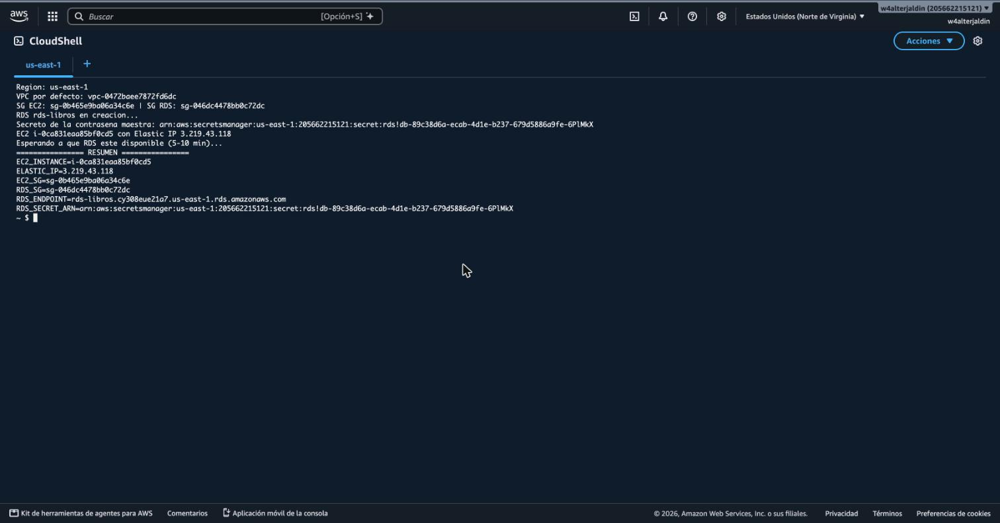

### 4.2 Security Groups

**EC2 (`ec2-libros-sg`)**: HTTP 80 y HTTPS 443 abiertos para IPv4 e IPv6, y SSH 22. No hay reglas para 3000 ni 3306.

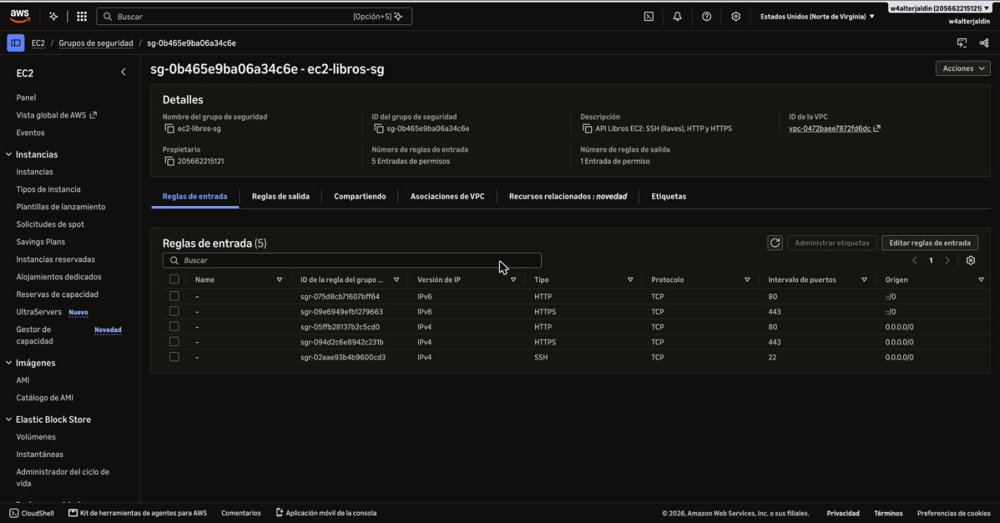

> **Justificación del SSH 22 abierto:** el job de despliegue se ejecuta en runners de GitHub con IP dinámica, así que no es posible restringir el origen a una IP fija. Como mitigación, el servidor **solo acepta autenticación con llave** (`PasswordAuthentication no`) y la llave del pipeline es exclusiva para ese fin. En un entorno real se usaría un runner self-hosted o AWS Systems Manager Session Manager para cerrar el puerto 22.

**RDS (`rds-libros-sg`)**: una única regla, MySQL/Aurora 3306 cuyo **origen es el Security Group de la EC2** (`sg-0b465e9ba06a34c6e`), no una IP ni `0.0.0.0/0`.


### 4.3 Instancia EC2

Instancia `ec2-api-libros` (`t3.micro`) en ejecución, con Elastic IP `3.219.43.118`, rol IAM `ec2-api-libros-role` e IMDSv2 obligatorio.


### 4.4 Amazon RDS privada

`PubliclyAccessible = False`, MySQL 8.4.11, `db.t4g.micro`, base inicial `db_libros` y la misma VPC que la EC2:


En la consola de RDS se ve que la puerta de enlace a Internet está **desactivada** y que las credenciales maestras están en **Secrets Manager**:

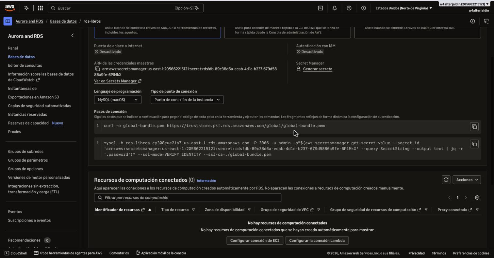

Reglas del grupo de seguridad asociadas a la base de datos (entrada solo desde el SG de la EC2):

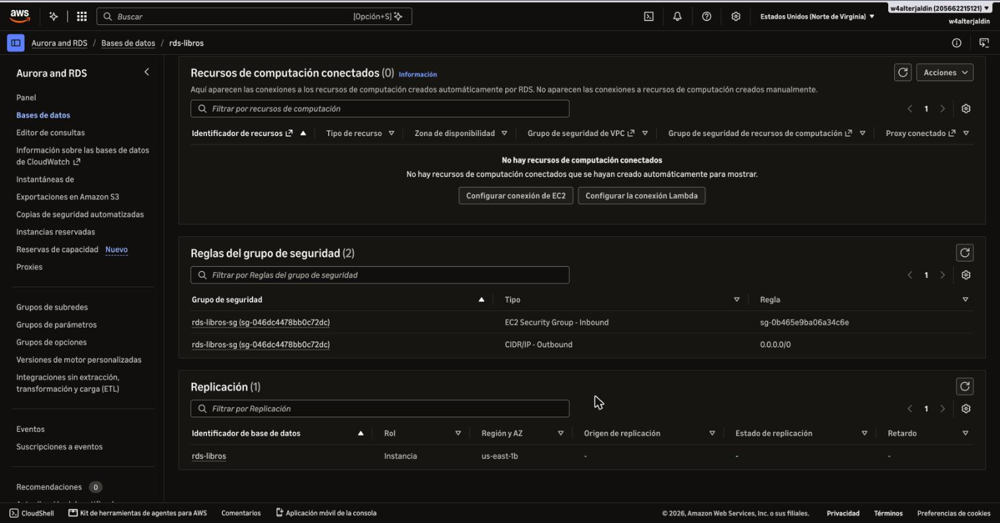

### 4.5 Usuario de la aplicación y conexión EC2 → RDS

Desde la EC2 se ejecutó una sola vez [`deploy/bootstrap-db.sh`](./deploy/bootstrap-db.sh). Este script:

1. Lee la contraseña maestra desde Secrets Manager con el rol IAM de la instancia.
2. Crea el usuario `usr_libros` con una contraseña aleatoria y solo los permisos `SELECT, INSERT, UPDATE, DELETE, CREATE, ALTER, INDEX` sobre `db_libros`.
3. Genera `/opt/api-libros/.env` con permisos `600`.

No se imprime ninguna contraseña.

```bash
scp -i admin_ed25519 deploy/bootstrap-db.sh ubuntu@3.219.43.118:/opt/api-libros/
ssh -i admin_ed25519 ubuntu@3.219.43.118 \
  "/opt/api-libros/bootstrap-db.sh rds-libros.cy308eue21a7.us-east-1.rds.amazonaws.com '<ARN del secreto>'"
# Usuario usr_libros creado y /opt/api-libros/.env generado (permisos 600).
```

La conexión desde la EC2 llega a RDS por su **IP privada** (`172.31.97.71`) en el puerto 3306. El usuario de la aplicación tiene los permisos mínimos:


### 4.6 Despliegue de la API

El despliegue lo realiza el pipeline del Tema 5 (sección 5.5). En la EC2 queda el contenedor `api-libros` publicado solo en `127.0.0.1:3000`; Nginx escucha en 80/443; el `.env` tiene permisos `600`, y `certbot.timer` renueva el certificado:


Configuración de Nginx: [`deploy/nginx-api-libros.conf`](./deploy/nginx-api-libros.conf).

### 4.7 Verificación de puertos expuestos

Desde Internet solo responden 22, 80 y 443. Los puertos 3000 (Node.js) y 3306 (MySQL) no son accesibles, y el endpoint de RDS solo resuelve a una IP privada de la VPC:


### 4.8 HTTPS con certificado válido

Como no se contaba con un subdominio propio, se usó **sslip.io**, un DNS público que resuelve `3-219-43-118.sslip.io` → `3.219.43.118`, y se obtuvo un certificado gratuito de **Let's Encrypt** con certbot (validación HTTP-01). El script [`deploy/enable-https.sh`](./deploy/enable-https.sh) automatiza este paso:

```bash
sudo ./enable-https.sh 3-219-43-118.sslip.io
```

El HTTP del dominio redirige con `301` a HTTPS. El acceso directo por la Elastic IP se mantiene por HTTP.


### 4.9 Operaciones CRUD y persistencia en RDS

Se ejecutaron todas las operaciones desde mi equipo contra la URL pública:

- **POST** → `201` con cabecera `Location`.
- Listado con filtro por género.
- **PATCH** y **PUT**.
- Validaciones: `400` con detalle de los errores, `409` por ISBN duplicado y `404` por id inexistente.
- Estadísticas del catálogo.


**DELETE y persistencia:** el libro creado aparece al consultar **directamente la tabla en RDS** desde la EC2. Tras el `DELETE` (`204`), la API responde `404` y en RDS ya no existe. El resto de los registros permanece en la base de datos, independiente del ciclo de vida del contenedor:


Vista en el navegador de la documentación Swagger, del listado y del health check:

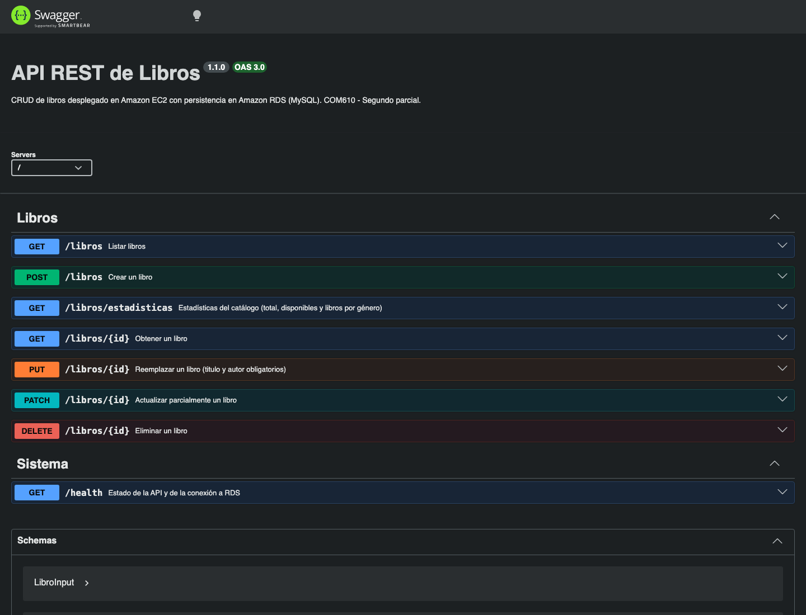


---

## 5. Tema 5 — Pruebas automatizadas y CI/CD con GitHub Actions

### 5.1 Pruebas automatizadas

| Tipo | Archivo | Qué cubre |
|---|---|---|
| Unitarias | [`tests/unit/validation.test.js`](./tests/unit/validation.test.js) | Reglas de validación, normalización de ISBN, modo parcial, `parseId`. |
| Unitarias (HTTP) | [`tests/unit/app.test.js`](./tests/unit/app.test.js) | Todos los endpoints con un repositorio en memoria: CRUD, filtros, paginación, 400/404/409/500, JSON mal formado, `/health` 200/503, Swagger. |
| Integración | [`tests/integration/libros.mysql.test.js`](./tests/integration/libros.mysql.test.js) | La API contra **MySQL 8.4 real**: migración idempotente, inserción y lectura directa en la tabla, ISBN único, PATCH, búsqueda, estadísticas y DELETE. |

**Lint local** (ESLint, 0 errores, 0 advertencias):


**Pruebas locales** con MySQL en Docker: 36 pruebas en verde y cobertura de 97–99 % en líneas y sentencias, por encima del umbral configurado del 80 %:


### 5.2 Imagen Docker multi-stage

El [`Dockerfile`](./Dockerfile) tiene tres etapas:

1. **builder**: ejecuta `lint` y `test` dentro del build; si fallan, la imagen no se genera.
2. **prod-deps**: instala solo las dependencias de producción.
3. **runtime**: `node:22-alpine` con parches del sistema, sin npm, ejecutándose como usuario `node` (no root), con `HEALTHCHECK` y etiquetas OCI de versión y commit.


### 5.3 Secretos y entorno `production`

Las credenciales de despliegue son **Environment Secrets** del entorno `production`. La URL pública (`API_URL`) y el interruptor `DEPLOY_ENABLED` son variables del repositorio (no secretas). En el repositorio no hay ningún archivo sensible:

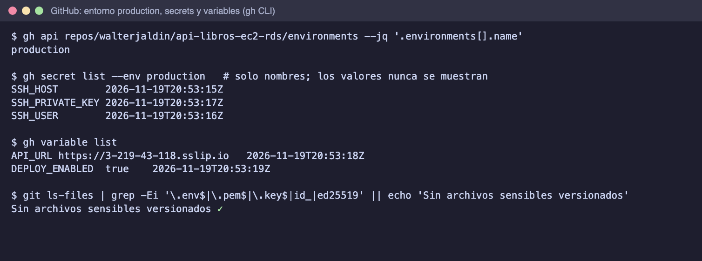

| Nombre | Tipo | Uso |
|---|---|---|
| `SSH_HOST` | Environment secret (`production`) | Elastic IP de la EC2 |
| `SSH_USER` | Environment secret (`production`) | `ubuntu` |
| `SSH_PRIVATE_KEY` | Environment secret (`production`) | Llave privada **exclusiva** del pipeline |
| `API_URL` | Variable | URL usada por el smoke test |
| `DEPLOY_ENABLED` | Variable | Activa el CD una vez creada la infraestructura |
| `GITHUB_TOKEN` | Automático | Push/pull de la imagen en GHCR |

### 5.4 Workflow de CI/CD

Archivo: [`.github/workflows/ci-cd.yml`](./.github/workflows/ci-cd.yml).

| Job | Cuándo | Qué hace |
|---|---|---|
| **Lint (ESLint)** | push, PR | `npm ci` + `npm run lint` |
| **Pruebas unitarias + integración (MySQL)** | push, PR | Levanta `mysql:8.4` como *service container*, ejecuta `npm run test:coverage` (umbral 80 %), publica la cobertura en el resumen y como artefacto |
| **Build imagen Docker + escaneo + push (GHCR)** | solo push a `main` | Build multi-stage con caché de GitHub Actions, push con tags `SHA`, `v<versión>` y `latest`, escaneo con **Grype** |
| **Deploy en EC2 (production)** | tras el build | SSH a la EC2: `docker login ghcr.io` con el token temporal del job, descarga [`deploy/deploy.sh`](./deploy/deploy.sh) del mismo commit y lo ejecuta |
| **Smoke test contra la URL pública** | tras el deploy | Verifica que `/health` reporte `status=ok`, `database=up` y **el mismo SHA del commit**; luego crea, consulta, modifica y elimina un libro en producción |

**Estrategia de despliegue con health check** ([`deploy/deploy.sh`](./deploy/deploy.sh)):

1. Arranca la nueva versión como `api-libros-new` en `127.0.0.1:3001`.
2. Espera hasta 60 s a que `/health` responda `200`. Eso implica que la nueva imagen se conecta a RDS.
3. Si responde bien, reemplaza al contenedor activo en `127.0.0.1:3000` (al que apunta Nginx). Si falla, elimina el contenedor nuevo, **mantiene la versión anterior** y el job termina con error.

### 5.5 Primera ejecución completa (v1.0.0)

El primer push con el despliegue habilitado ejecutó todos los jobs con éxito y dejó en producción la versión `1.0.0` (commit `610cd66`).

### 5.6 Flujo con Pull Request: solo CI

Se creó la rama `feat/estadisticas` con el nuevo endpoint `GET /libros/estadisticas`, sus pruebas y la versión `1.1.0`, y se abrió el [PR #1](https://github.com/walterjaldin/api-libros-ec2-rds/pull/1). En el PR solo se ejecutan **lint y pruebas**; build, deploy y smoke test se **omiten**, de modo que nada llega a producción sin pasar por `main`:


### 5.7 Merge a `main`: despliegue continuo de la v1.1.0

Al hacer merge del PR, el pipeline completo se ejecutó automáticamente y desplegó la v1.1.0:


**Log del job de pruebas en CI** (MySQL como *service container*):


**Escaneo de vulnerabilidades (Grype):** la imagen no tiene vulnerabilidades **CRITICAL ni HIGH**. Hay 3 de severidad **MEDIUM** en `busybox`, que proviene de la imagen base Alpine y no tiene parche disponible. El job está configurado con `severity-cutoff: high` y publica la tabla en el resumen del workflow.

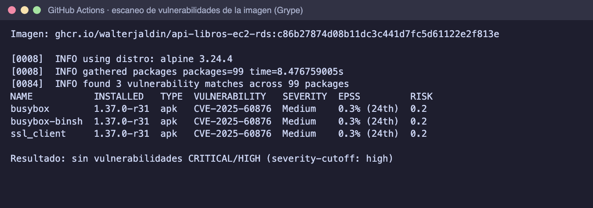

**Log del despliegue con health check:** se ve cómo la nueva versión se valida antes de activarse:

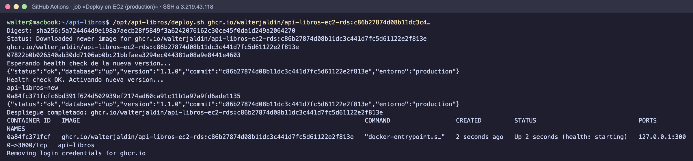

**Smoke test contra producción:** `/health` reporta el SHA del commit desplegado y el CRUD funciona sobre RDS:

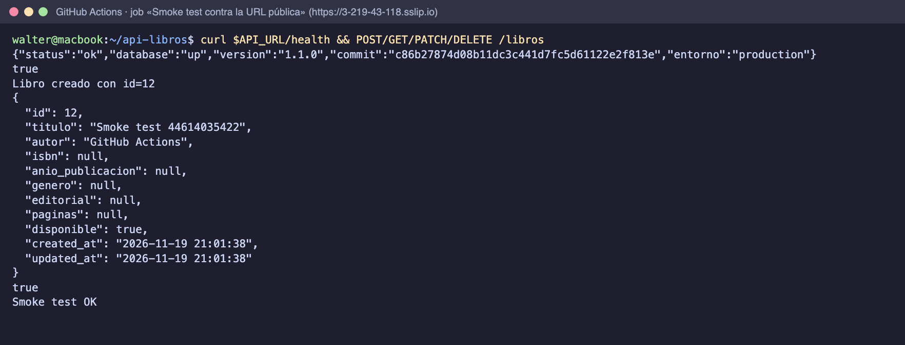

**Historial de ejecuciones:**


### 5.8 Rollback

Cada imagen queda en GHCR con el SHA de su commit. El workflow [`rollback.yml`](./.github/workflows/rollback.yml) (`workflow_dispatch`) recibe un tag y lo despliega con el **mismo script y el mismo health check**. Para probarlo se volvió a la v1.0.0:

```bash
gh workflow run rollback.yml -f tag=610cd66248b7128e1bebd141b0d1a9edf06575da
```


Resultado: producción responde con `version: 1.0.0`, el endpoint `/libros/estadisticas` (que no existía en esa versión) deja de estar disponible, y **los datos siguen intactos** porque viven en RDS y no en el contenedor:

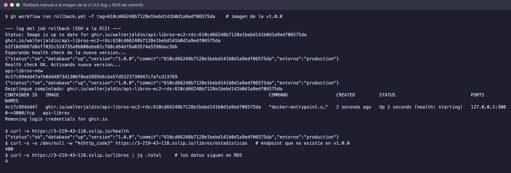

Luego se volvió a la última versión (*roll-forward*) con un nuevo push a `main`:

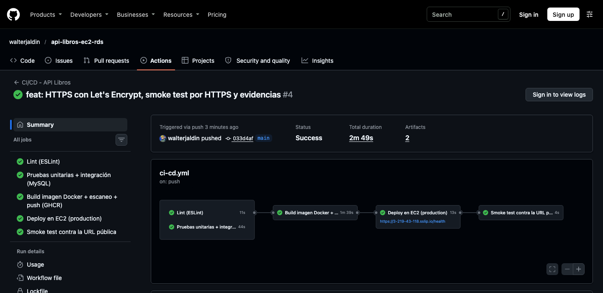

El rollback también puede hacerse a mano en la EC2:

```bash
docker login ghcr.io
/opt/api-libros/deploy.sh ghcr.io/walterjaldin/api-libros-ec2-rds:<SHA_ANTERIOR>
```

---

## 6. Seguridad: qué no se publicó y por qué

| Elemento sensible | Dónde está | Nunca en el repositorio |
|---|---|---|
| Contraseña maestra de RDS | AWS Secrets Manager (generada por AWS) | ✔ |
| Contraseña de `usr_libros` | `/opt/api-libros/.env` en la EC2 (permisos 600) | ✔ |
| Llave privada de administración | Equipo local, fuera del repositorio | ✔ |
| Llave privada del pipeline | GitHub Environment Secret `SSH_PRIVATE_KEY` | ✔ |
| Token de GHCR | `GITHUB_TOKEN` temporal del job (logout tras el deploy) | ✔ |
| Certificado TLS (clave privada) | `/etc/letsencrypt` en la EC2 | ✔ |

- `.gitignore` excluye `.env`, `*.pem`, `*.key` y `keys/`. Solo se versiona [`.env.example`](./.env.example) con valores ficticios.
- La contraseña `ci_root_pw` del workflow pertenece a un MySQL **efímero** que solo existe dentro del runner de CI. No es una credencial real.
- En las capturas se ocultó la contraseña del `.env` (`********`) y se usó `MYSQL_PWD` desde el archivo, sin escribirla en la línea de comandos.

## 7. Problemas encontrados y cómo se resolvieron

| Problema | Solución |
|---|---|
| No usar contraseñas en texto plano al crear RDS desde el navegador. | `--manage-master-user-password` (Secrets Manager) y rol IAM en la EC2 restringido a ese secreto. |
| El primer push habría intentado desplegar antes de que existiera la EC2. | Variable `DEPLOY_ENABLED`: el CD solo se activa cuando la infraestructura está lista. |
| Chrome mostraba "Este sitio no admite una conexión segura" al abrir la API por HTTP. | HTTPS con Let's Encrypt usando `3-219-43-118.sslip.io` y renovación automática (`certbot.timer`). |
| El script de opciones TLS de certbot no se pudo descargar (404 en GitHub). | Se generó `options-ssl-nginx.conf` con la configuración TLS 1.2/1.3 recomendada (ya incluido en `enable-https.sh`). |
| Avisos de deprecación de Node 20 en las actions. | Se actualizaron a `checkout@v7`, `setup-node@v7`, `docker/*@v4/v7`, `scan-action@v7` y `upload-artifact@v7` en el PR #1. |
| Los runners de GitHub tienen IP dinámica y no se puede restringir el SSH. | SSH solo con llave, llave dedicada al pipeline y login por contraseña desactivado (ver 4.2). |

## 8. Costos y limpieza

Los recursos se mantienen activos durante la revisión: EC2 `t3.micro`, RDS `db.t4g.micro` con 20 GB gp3 y una Elastic IP. Para eliminarlos después:

```bash
aws ec2 terminate-instances --instance-ids i-0ca831eaa85bf0cd5
aws rds delete-db-instance --db-instance-identifier rds-libros --skip-final-snapshot
aws ec2 release-address --allocation-id <ALLOCATION_ID>
aws ec2 delete-security-group --group-id sg-046dc4478bb0c72dc   # rds-libros-sg (tras borrar RDS)
aws ec2 delete-security-group --group-id sg-0b465e9ba06a34c6e   # ec2-libros-sg (tras terminar la EC2)
aws iam remove-role-from-instance-profile --instance-profile-name ec2-api-libros-profile --role-name ec2-api-libros-role
aws iam delete-instance-profile --instance-profile-name ec2-api-libros-profile
aws iam delete-role-policy --role-name ec2-api-libros-role --policy-name leer-secreto-rds
aws iam delete-role --role-name ec2-api-libros-role
```

## 9. Conclusiones

- La API de libros funciona en EC2 y persiste en una RDS que **no es accesible desde Internet**. La comunicación EC2 → RDS se controla con referencias entre Security Groups en lugar de IPs, y la contraseña maestra nunca salió de Secrets Manager.
- El pipeline garantiza que solo llegue a producción código que pasó lint, 36 pruebas (incluidas las de integración con MySQL real) y un escaneo de vulnerabilidades. El despliegue con health check evita reemplazar una versión sana por una rota, y el smoke test confirma desde fuera que la versión publicada es exactamente la del commit.
- Etiquetar cada imagen con el SHA del commit hizo el rollback trivial: se volvió a la v1.0.0 en segundos sin perder datos, porque el estado vive en RDS y los contenedores no guardan estado.
- Como mejoras para un entorno real quedan: cifrado de almacenamiento en RDS (`--storage-encrypted`), Multi-AZ, despliegue con AWS SSM en lugar de SSH abierto, y un dominio propio en lugar de sslip.io.
