# Segundo examen parcial

**Trabajando en la Nube (COM610)** 

**Docente:** Ing. Marcelo Quispe Ortega

**Estudiante:** Walter Jaldin Gonzales

**Repositorio:** [https://github.com/walterjaldin/api-libros-ec2-rds](https://github.com/walterjaldin/api-libros-ec2-rds)


| Recurso                       | URL                                                                                                                      |
| ----------------------------- | ------------------------------------------------------------------------------------------------------------------------ |
| API pública (HTTPS)           | [https://3-219-43-118.sslip.io](https://3-219-43-118.sslip.io)                                                           |
| Health check                  | [https://3-219-43-118.sslip.io/health](https://3-219-43-118.sslip.io/health)                                             |
| Swagger / OpenAPI             | [https://3-219-43-118.sslip.io/docs](https://3-219-43-118.sslip.io/docs)                                                 |
| Acceso directo por Elastic IP | [http://3.219.43.118/health](http://3.219.43.118/health)                                                                 |
| Pipeline (GitHub Actions)     | [https://github.com/walterjaldin/api-libros-ec2-rds/actions](https://github.com/walterjaldin/api-libros-ec2-rds/actions) |
| Ejecución exitosa de CI       | [https://github.com/walterjaldin/api-libros-ec2-rds/actions/runs/44631829896](https://github.com/walterjaldin/api-libros-ec2-rds/actions/runs/44631829896) |
| Ejecución exitosa de CD       | [https://github.com/walterjaldin/api-libros-ec2-rds/actions/runs/44631829904](https://github.com/walterjaldin/api-libros-ec2-rds/actions/runs/44631829904) |
| Imagen publicada (GHCR)       | [ghcr.io/walterjaldin/api-libros-ec2-rds](https://github.com/users/walterjaldin/packages/container/package/api-libros-ec2-rds) |


---

---

## 1. Resumen de la solución


| Ejercicio  | Qué se implementó                                                                                                                                                                                                                                                                                                                                                                                                                                                                                                                                                                     |
| ---------- | ------------------------------------------------------------------------------------------------------------------------------------------------------------------------------------------------------------------------------------------------------------------------------------------------------------------------------------------------------------------------------------------------------------------------------------------------------------------------------------------------------------------------------------------------------------------------------------- |
| **Tema 4** | API REST de libros con CRUD completo, validaciones, paginación, búsqueda, estadísticas y documentación Swagger. Se despliega en la EC2 `ec2-api-libros-wjg` (**t3.micro, Ubuntu 24.04**) con Elastic IP, detrás de **Nginx** como proxy inverso en el puerto 80. Persiste en la RDS `rds-libros-wjg` (**MySQL 8.4**, sin acceso público, misma VPC); el puerto 3306 solo acepta tráfico desde el Security Group de la EC2. La contraseña maestra de RDS la gestiona **AWS Secrets Manager**.                                                                                                                                                                                    |
| **Tema 5** | Pruebas con Jest + Supertest que se ejecutan **sin RDS real** gracias a un doble de prueba de la capa de datos (44 pruebas) más pruebas de integración opcionales con MySQL. **`ci.yml`** ejecuta `npm ci` y `npm test` en cada push y PR a `main`. **`cd.yml`** (solo `main`): pruebas → imagen Docker publicada en **GHCR con el SHA del commit** → deploy en la EC2 → verificación de `/health` y `/libros`. Si la nueva versión no pasa la verificación, el workflow falla y **se conserva la versión anterior**. El acceso SSH del pipeline se abre solo durante el deploy mediante **OIDC**. |


## 2. Desarrollo de la API REST de libros

### 2.1 Estructura del código


| Archivo                                                                          | Responsabilidad                                                                                                                        |
| -------------------------------------------------------------------------------- | -------------------------------------------------------------------------------------------------------------------------------------- |
| [`src/server.js`](./src/server.js)                                               | Arranque: crea el pool de MySQL, ejecuta la migración idempotente y levanta Express.                                                   |
| [`src/app.js`](./src/app.js)                                                     | `/`, `/health`, Swagger (`/docs`, `/openapi.json`), 404 y manejador central de errores (JSON mal formado → 400, ISBN duplicado → 409). |
| [`src/routes.js`](./src/routes.js)                                               | CRUD `/libros` (GET lista y por id, POST, PUT, PATCH, DELETE) y `/libros/estadisticas`.                                                |
| [`src/validation.js`](./src/validation.js)                                       | Validación de campos: obligatorios, tipos, longitudes, rango de año, ISBN‑10/13, campos no permitidos.                                 |
| [`src/repositories/librosRepository.js`](./src/repositories/librosRepository.js) | Consultas SQL parametrizadas (sin riesgo de inyección SQL).                                                                            |
| [`db.sql`](./db.sql)                                                             | Crea la tabla `libros` (`id`, `titulo`, `autor`, `anio_publicacion` y campos opcionales). La API lo ejecuta al arrancar.                |


### 2.2 Endpoints


| Método | Ruta                                     | Descripción                                            | Códigos         |
| ------ | ---------------------------------------- | ------------------------------------------------------ | --------------- |
| GET    | `/health`                                | Estado de la API y de RDS, versión y commit desplegado | 200 / 503       |
| GET    | `/libros?q=&autor=&genero=&page=&limit=` | Lista paginada con filtros                             | 200             |
| GET    | `/libros/estadisticas`                   | Total, disponibles y libros por género (v1.1.0)        | 200             |
| GET    | `/libros/:id`                            | Obtiene un libro                                       | 200 / 400 / 404 |
| POST   | `/libros`                                | Crea (`titulo`, `autor` y `anio_publicacion` obligatorios) | 201 / 400 / 409 |
| PUT    | `/libros/:id`                            | Reemplaza                                              | 200 / 400 / 404 |
| PATCH  | `/libros/:id`                            | Actualización parcial                                  | 200 / 400 / 404 |
| DELETE | `/libros/:id`                            | Elimina                                                | 204 / 400 / 404 |


---

## 3. Despliegue en Amazon EC2 con persistencia en Amazon RDS

### 3.1 Creación de la infraestructura 

La infraestructura se creó en la región **us-east-1 (Norte de Virginia)** 

#### Paso 1 — Llaves SSH

Se generaron dos pares de llaves **ed25519** en mi equipo, fuera del repositorio:

- `admin-api-libros`: para administrar la EC2.
- `github-actions-deploy`: exclusiva para el pipeline de despliegue.

Solo las llaves **públicas** se suben a AWS.

```bash
ssh-keygen -t ed25519 -C admin-api-libros -f keys/admin_ed25519
ssh-keygen -t ed25519 -C github-actions-deploy -f keys/deploy_ed25519
```

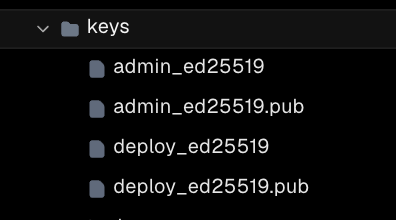

#### Paso 2 — VPC

Se usó la **VPC por defecto** (`vpc-0472baee7872fd6dc`, `172.31.0.0/16`), donde quedan la EC2 y la RDS para que se comuniquen por la red privada.


#### Paso 3 — Security Groups

Se creó `ec2-libros-sg` para la EC2, con SSH (22) **solo desde mi IP pública**, HTTP (80) y HTTPS (443) desde Internet. También se creó `rds-libros-sg` para la base de datos, que solo permite el 3306 **desde el SG de la EC2**. El detalle de las reglas está en la sección 3.2.

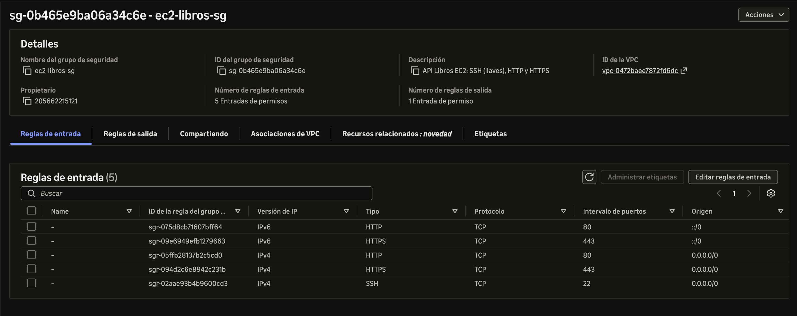

#### Paso 4 — Base de datos Amazon RDS for MySQL

Se creó la instancia `rds-libros` con estas características:

- MySQL 8.4, clase `db.t4g.micro`, 20 GB gp3.
- **Sin acceso público**.
- Base inicial `db_libros`.
- Asociada a `rds-libros-sg`.


#### Paso 5 — Secreto en AWS Secrets Manager

Al crear la RDS se generó automáticamente el secreto `rds!db-89c38d6a-...` con el usuario y la contraseña maestra.

#### Paso 6 — Rol IAM para la EC2

Se creó el rol `ec2-api-libros-role` con la política `leer-secreto-rds`. Esa política solo permite `secretsmanager:GetSecretValue` sobre el secreto de la RDS. Después se creó el perfil de instancia `ec2-api-libros-profile` para asociar el rol a la EC2.


#### Paso 7 — Par de claves en EC2

Se importó la llave pública de administración como el key pair `admin-api-libros`.

#### Paso 8 — Instancia EC2

Se lanzó la instancia `ec2-api-libros` con estas características:

- Ubuntu Server 24.04, `t3.micro`, disco gp3 de 12 GB.
- Key pair `admin-api-libros`.
- SG `ec2-libros-sg`.
- Perfil IAM `ec2-api-libros-profile`.

#### Paso 9 — Elastic IP

Se reservó una Elastic IP y se asoció a la instancia, para que la dirección pública (`3.219.43.118`) no cambie si la EC2 se reinicia.

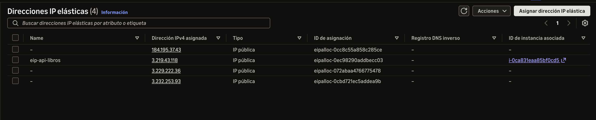

#### Paso 10 — Identificación de los recursos con mis iniciales (`wjg`)

Los recursos se identificaron con mis iniciales: la EC2 `ec2-api-libros-wjg`, la RDS `rds-libros-wjg` (renombrada con `modify-db-instance --new-db-instance-identifier`), los Security Groups (`Name` = `ec2-libros-sg-wjg` y `rds-libros-sg-wjg`) y la Elastic IP `eip-api-libros-wjg`. También se agregó la etiqueta `Owner=wjg`.

```bash
aws ec2 create-tags --resources i-0ca831eaa85bf0cd5 --tags Key=Name,Value=ec2-api-libros-wjg Key=Owner,Value=wjg
aws rds modify-db-instance --db-instance-identifier rds-libros --new-db-instance-identifier rds-libros-wjg --apply-immediately
```

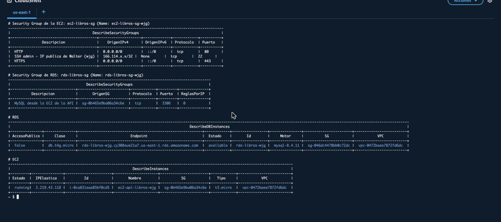

#### Paso 11 — Verificación de la EC2

Se ingresó por SSH y se comprobó que Docker, Nginx  quedaron instalados.

```bash
ssh -i keys/admin_ed25519 ubuntu@3.219.43.118
cloud-init status
docker --version && nginx -v 
```

### 3.2 Security Groups

**EC2 (`ec2-libros-sg`)**:

- SSH (22) **solo desde mi IP pública** (`166.114.x.x/32`, oculta en las capturas).
- HTTP (80) y HTTPS (443) abiertos para IPv4 e IPv6.
- No hay reglas para 3000 ni 3306.

Las reglas se ven en la captura del paso 10 (sección 3.1).

El pipeline de despliegue **no** deja el 22 abierto. En cada deploy, GitHub Actions obtiene credenciales temporales de AWS mediante **OIDC** y agrega una regla `22/tcp` solo para la IP del runner. Al terminar la elimina, aunque el despliegue falle (sección 4.5). El rol IAM `github-actions-deploy-wjg` solo puede autorizar y revocar reglas en este Security Group, y solo lo puede asumir el entorno `production` de este repositorio.

**RDS (`rds-libros-sg`)**: una única regla, MySQL/Aurora 3306 cuyo **origen es el Security Group de la EC2** (`sg-0b465e9ba06a34c6e`), no una IP ni `0.0.0.0/0`.


### 3.3 Instancia EC2

Instancia `ec2-api-libros-wjg` (`t3.micro`) en ejecución, con Elastic IP `3.219.43.118`, rol IAM `ec2-api-libros-role` e IMDSv2 obligatorio.

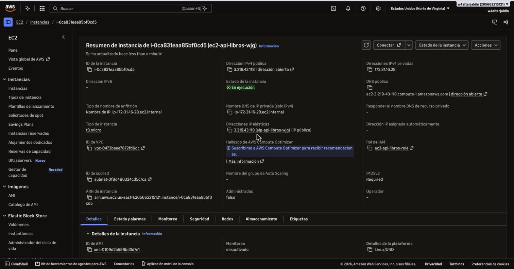

### 3.4 Amazon RDS privada

`rds-libros-wjg`: `PubliclyAccessible = False`, MySQL 8.4.11, `db.t4g.micro`, base inicial `db_libros`, en la misma VPC que la EC2 (`vpc-0472baee7872fd6dc`). Ver la tabla «RDS» de la captura del paso 10.

En la consola de RDS se ve que la puerta de enlace a Internet está **desactivada** y que las credenciales maestras están en **Secrets Manager**:

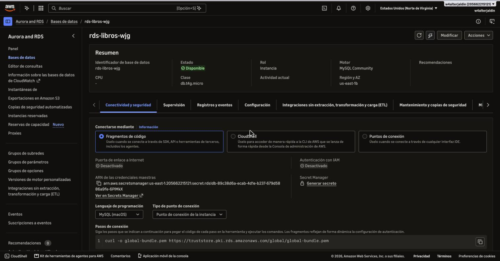

Reglas del grupo de seguridad asociadas a la base de datos (entrada solo desde el SG de la EC2):


### 3.5 Usuario de la aplicación y conexión EC2 → RDS

1. Crea el usuario `usr_libros` con una contraseña y solo los permisos `SELECT, INSERT, UPDATE, DELETE, CREATE, ALTER, INDEX` sobre `db_libros`.

```bash
mysql -h "$ENDPOINT" -u "$MASTER_USER" <<SQL
CREATE DATABASE IF NOT EXISTS db_libros CHARACTER SET utf8mb4 COLLATE utf8mb4_unicode_ci;
CREATE USER IF NOT EXISTS 'usr_libros'@'%' IDENTIFIED BY '${APP_PW}';
ALTER USER 'usr_libros'@'%' IDENTIFIED BY '${APP_PW}';
GRANT SELECT, INSERT, UPDATE, DELETE, CREATE, ALTER, INDEX ON db_libros.* TO 'usr_libros'@'%';
FLUSH PRIVILEGES;
SQL
unset MYSQL_PWD
```

La conexión desde la EC2 llega a RDS por su **IP privada** (`172.31.97.71`) en el puerto 3306. El usuario de la aplicación tiene los permisos mínimos:


### 3.6 Despliegue de la API

El despliegue lo realiza el pipeline del Tema 5 (sección 4.5). La configuración de RDS vive solo en `/opt/api-libros/.env` de la EC2, fuera del repositorio y de la imagen, y se inyecta con `docker run --env-file`. En la EC2 queda el contenedor `api-libros` publicado solo en `127.0.0.1:3000`; Nginx escucha en 80/443; el `.env` tiene permisos `600`, y `certbot.timer` renueva el certificado:

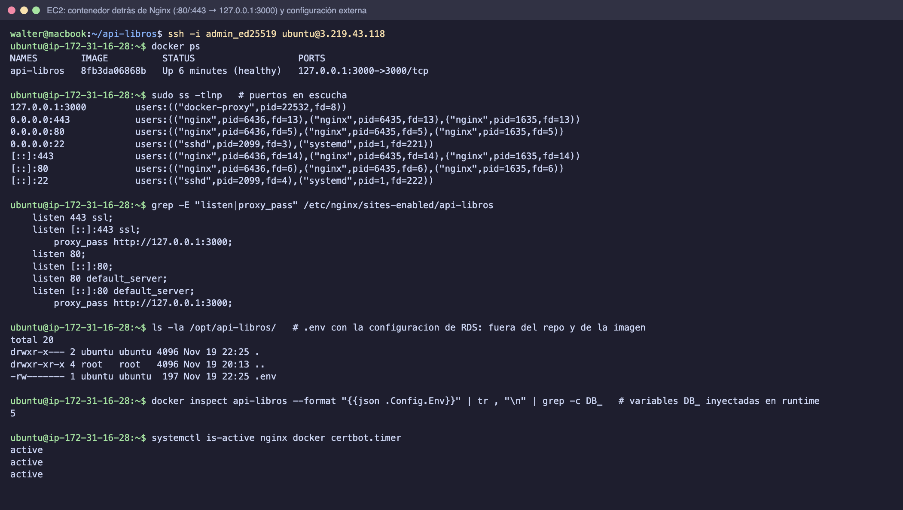

### 3.7 Verificación de puertos expuestos

Desde Internet, los puertos 3000 (Node.js) y 3306 (MySQL) no son accesibles, y el endpoint de RDS solo resuelve a una IP privada de la VPC. El 22 responde únicamente porque la prueba se hizo desde mi IP, que es la única autorizada:

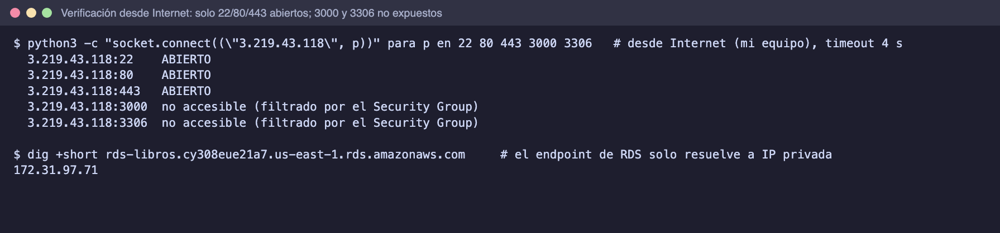

### 3.8 HTTPS con certificado válido

Como no contamos con un subdominio propio, se usó **sslip.io**, un DNS público que resuelve `3-219-43-118.sslip.io` → `3.219.43.118`, y se obtuvo un certificado gratuito de **Let's Encrypt** con certbot. 

```bash
certbot certonly --webroot -w /var/www/html -d "$DOMAIN" --agree-tos --register-unsafely-without-email --non-interactive
cat > /etc/letsencrypt/options-ssl-nginx.conf <<CONF
ssl_session_cache shared:le_nginx_SSL:10m;
ssl_session_timeout 1440m;
ssl_session_tickets off;
ssl_protocols TLSv1.2 TLSv1.3;
ssl_prefer_server_ciphers off;
ssl_ciphers "ECDHE-ECDSA-AES128-GCM-SHA256:ECDHE-RSA-AES128-GCM-SHA256:ECDHE-ECDSA-AES256-GCM-SHA384:ECDHE-RSA-AES256-GCM-SHA384:ECDHE-ECDSA-CHACHA20-POLY1305:ECDHE-RSA-CHACHA20-POLY1305";
CONF
```

El HTTP del dominio redirige con `301` a HTTPS. El acceso directo por la Elastic IP se mantiene por HTTP.

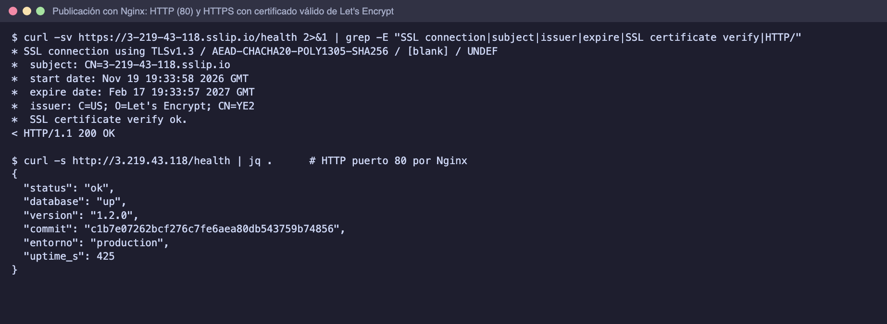

### 3.9 Operaciones CRUD y persistencia en RDS

Desde mi equipo, con `curl` contra la URL pública, se hizo una **creación**, una **consulta**, una **actualización** y una **eliminación**. Después de cada operación se consultó **directamente la tabla en RDS** desde la EC2 para comprobar que el cambio quedó guardado:

- **POST** → `201` con el registro y la cabecera `Location`; el libro aparece en RDS.
- **GET** → `200` con el libro.
- **PUT** → `200`; en RDS cambian `titulo`, `anio_publicacion` y `updated_at`.
- **DELETE** → `204`; luego `GET` responde `404` y en RDS el registro ya no existe.

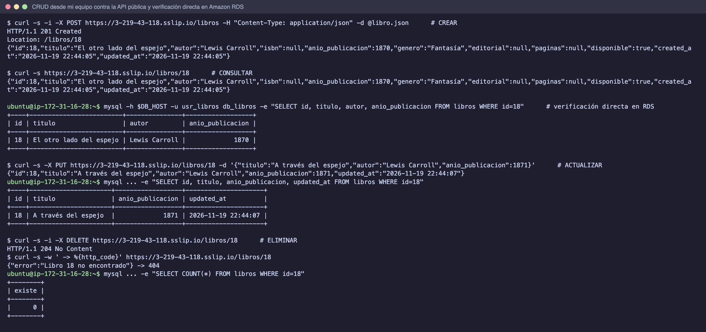

**Validaciones y errores.** Las validaciones responden `400`: `titulo` o `autor` vacíos, `anio_publicacion` ausente o no entero. Un id inexistente responde `404` en `GET`, `PUT` y `DELETE`. Al final, el listado de la API coincide con el contenido de la tabla en RDS:

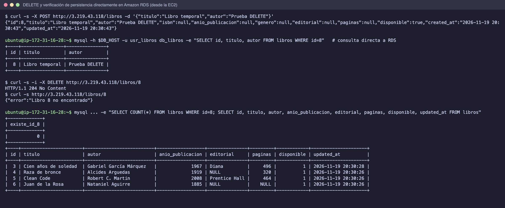

Vista en el navegador de la documentación Swagger, del listado y del health check:


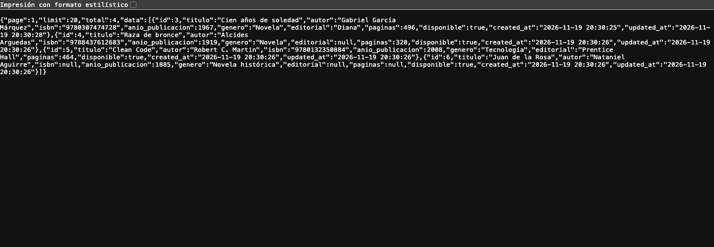

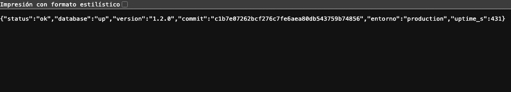

---

## 4. Pruebas automatizadas y CI/CD con GitHub Actions

### 4.1 Pruebas automatizadas

Las pruebas usan **Jest + Supertest**. Se ejecutan con `npm test` y **no necesitan una instancia RDS real**: la API recibe la capa de datos por parámetro (`createApp({ repo })`), y en las pruebas se le pasa un **doble de prueba** en memoria ([`tests/helpers/memoryRepo.js`](./tests/helpers/memoryRepo.js)) con la misma interfaz que el repositorio de MySQL.

| Tipo | Archivo | Qué cubre |
|---|---|---|
| Requisitos del examen + CRUD (HTTP) | [`tests/unit/app.test.js`](./tests/unit/app.test.js) | `GET /health` 200, creación válida 201, rechazo de datos inválidos 400, `404` de un libro inexistente, más CRUD completo, filtros, 409, 500, JSON mal formado y Swagger. |
| Validación y `db.sql` | [`tests/unit/validation.test.js`](./tests/unit/validation.test.js) | Reglas de `titulo`, `autor` y `anio_publicacion`; que `db.sql` cree la tabla con los campos requeridos. |
| Integración (extra) | [`tests/integration/libros.mysql.test.js`](./tests/integration/libros.mysql.test.js) | La API contra **MySQL 8.4 real**. Solo se ejecuta con `RUN_INTEGRATION=1`, por eso no es necesaria para `npm test`. |

**Lint local** (ESLint, 0 errores, 0 advertencias):


**`npm test` en local**, sin base de datos: 44 pruebas en verde. Los cuatro casos mínimos del enunciado están agrupados en «Requisitos mínimos del examen»:

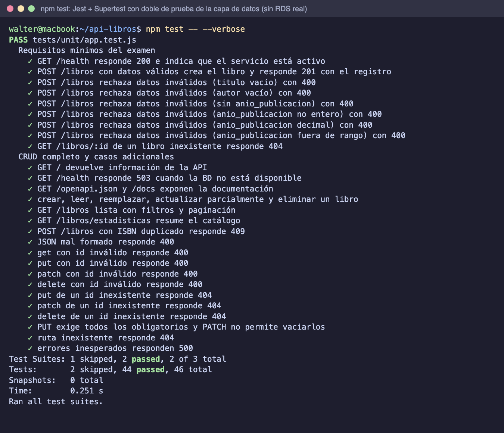

### 4.2 Imagen Docker

El [`Dockerfile`](./Dockerfile) tiene tres etapas:

1. **builder**: ejecuta `lint` y `test` dentro del build; si fallan, la imagen no se genera.
2. **prod-deps**: instala solo las dependencias de producción.
3. **runtime**: `node:22-alpine`, sin npm, ejecutándose como usuario `node` (no root), con `HEALTHCHECK`.

La imagen **no contiene configuración de la base de datos**: el contenedor la recibe por variables de entorno (`-e` o `--env-file`). Se construyó y se probó en local contra un MySQL en Docker:

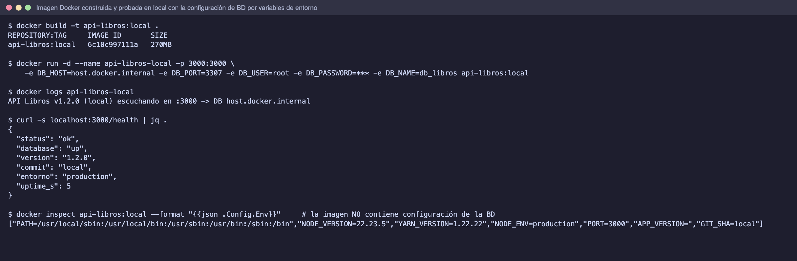

### 4.3 Secrets de GitHub Actions

Las credenciales de acceso a EC2 y a AWS son **secrets del entorno `production`**. El registro de contenedores (GHCR) usa el secret automático `GITHUB_TOKEN`, que es temporal y propio de cada ejecución. En el repositorio no hay `.env`, `.pem` ni claves.

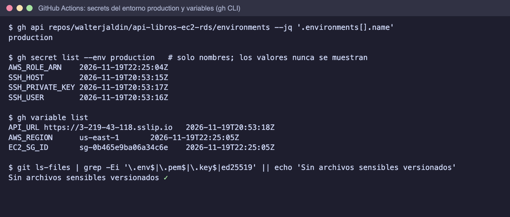

| Nombre | Tipo | Uso |
|---|---|---|
| `SSH_HOST` | Secret (`production`) | Elastic IP de la EC2 |
| `SSH_USER` | Secret (`production`) | `ubuntu` |
| `SSH_PRIVATE_KEY` | Secret (`production`) | Llave privada **exclusiva** del pipeline |
| `AWS_ROLE_ARN` | Secret (`production`) | Rol IAM `github-actions-deploy-wjg` que se asume por OIDC (sin claves de acceso guardadas) |
| `GITHUB_TOKEN` | Secret automático | Login y push/pull en `ghcr.io` |
| `API_URL`, `AWS_REGION`, `EC2_SG_ID` | Variables | URL pública, región y Security Group de la EC2 (no son secretos) |

### 4.4 Workflow de CI — [`ci.yml`](./.github/workflows/ci.yml)

Se ejecuta en cada **push** y **pull_request** hacia `main`:

| Job | Qué hace |
|---|---|
| **npm ci + lint + npm test** | `npm ci`, `npm run lint` y `npm test`. Si una prueba falla, el job y la ejecución quedan en rojo. |
| **Pruebas de integración con MySQL (extra)** | Levanta `mysql:8.4` como *service container* y ejecuta las pruebas con cobertura (umbral 80 %). La contraseña `ci_root_pw` pertenece a ese MySQL efímero del runner; no es una credencial real. |

Ejecución exitosa en `main` ([run 44631829896](https://github.com/walterjaldin/api-libros-ec2-rds/actions/runs/44631829896)):

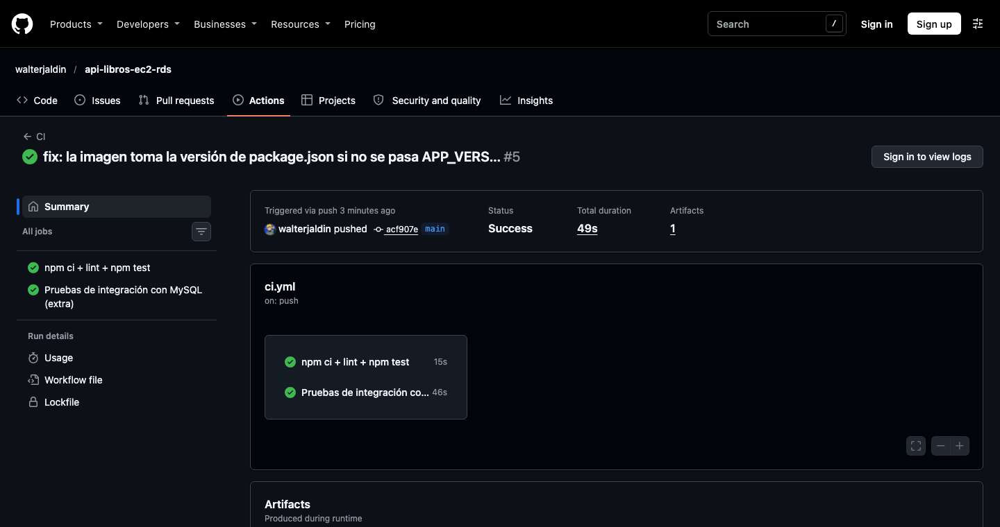

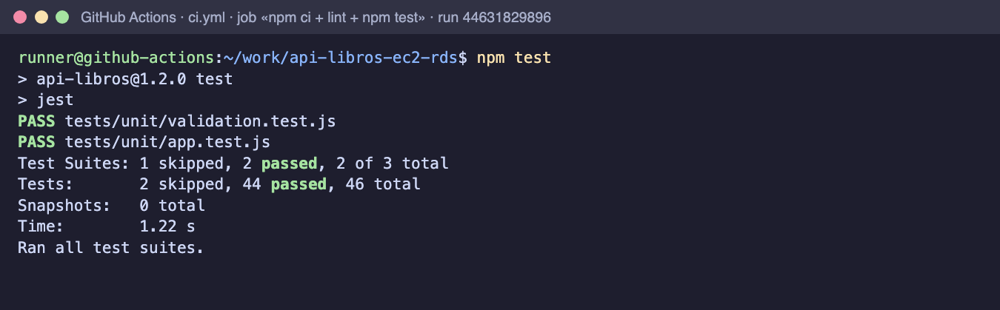

**Una prueba fallida marca la ejecución como fallida.** Para demostrarlo se abrió el [PR #2](https://github.com/walterjaldin/api-libros-ec2-rds/pull/2) con una prueba que falla a propósito (espera `200` donde la API responde `404`). La CI quedó en rojo, no se ejecutó ningún despliegue, y el PR se cerró sin fusionar:

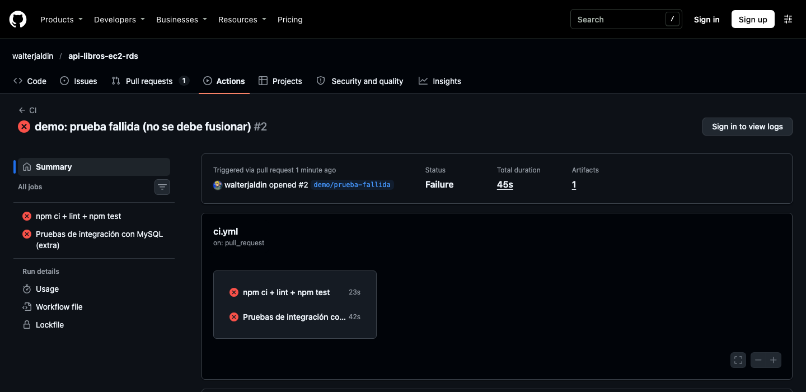

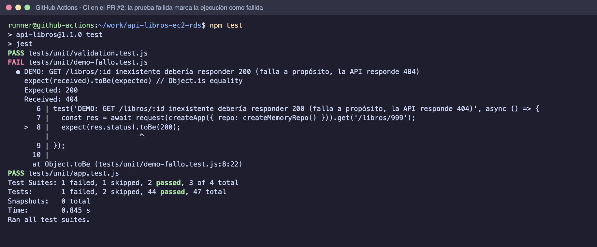

### 4.5 Workflow de CD — [`cd.yml`](./.github/workflows/cd.yml)

Se ejecuta **solo por cambios incorporados a `main`** (`push` a `main`; un `pull_request` no lo dispara). Tiene cuatro trabajos dependientes (`needs`), en este orden:

| Job | Qué hace |
|---|---|
| **1. Pruebas** | `npm ci`, lint y `npm test`. Si fallan, no se construye ni se despliega nada. |
| **2. Build y push de la imagen** | Construye la imagen y la publica en `ghcr.io/walterjaldin/api-libros-ec2-rds` con el tag **SHA del commit** (también `v<versión>` y `latest`). Escanea vulnerabilidades con Grype. |
| **3. Deploy en EC2** | Obtiene credenciales temporales de AWS por **OIDC** y abre el 22 **solo para la IP del runner**. Por SSH descarga la imagen del SHA, la verifica y la activa. Al final cierra el 22, siempre, aunque el paso falle. |
| **4. Verificar despliegue** | Desde Internet comprueba que `/health` responda `ok`, `database: up` y **el mismo SHA del commit**. Además consulta `/libros` y hace un CRUD de verificación. |

**Despliegue seguro con conservación de la versión anterior** (paso 3):

1. Guarda cuál es la imagen activa (`PREV`).
2. Arranca la nueva versión como `api-libros-new` en `127.0.0.1:3001`, con la configuración de RDS del `.env` de la EC2.
3. Verifica **`/health` y `GET /libros`** en ese puerto durante hasta 60 s. **Si falla**, elimina el contenedor nuevo, **conserva la versión anterior** y el workflow termina en error.
4. Si pasa, reemplaza el contenedor activo en `127.0.0.1:3000`, el puerto al que apunta Nginx. El 3000 nunca se publica a Internet.
5. Vuelve a verificar `/health` y `/libros` a través de Nginx. Si falla, **restaura `PREV`** y el workflow falla.

Ejecución exitosa en `main`:

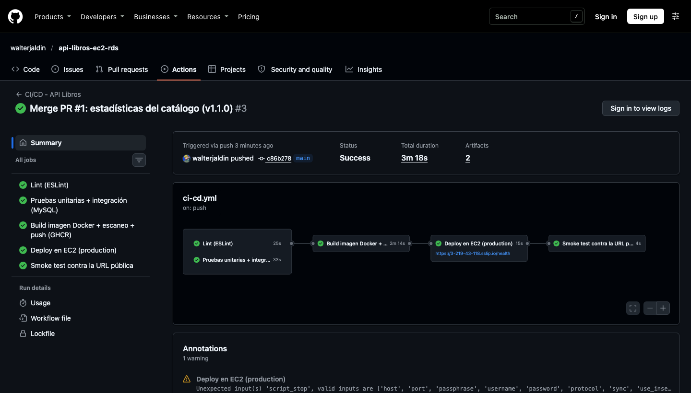

**Imagen publicada** en GHCR, identificada con el SHA de cada commit:

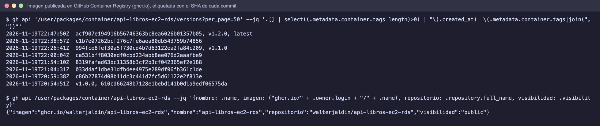

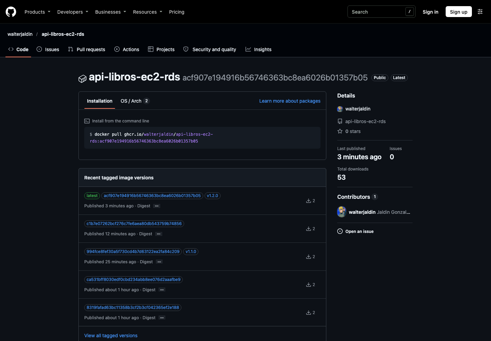

**Escaneo de vulnerabilidades (Grype):** sin vulnerabilidades **CRITICAL ni HIGH**. Hay 3 de severidad **MEDIUM** en `busybox`, de la imagen base Alpine, sin parche disponible.

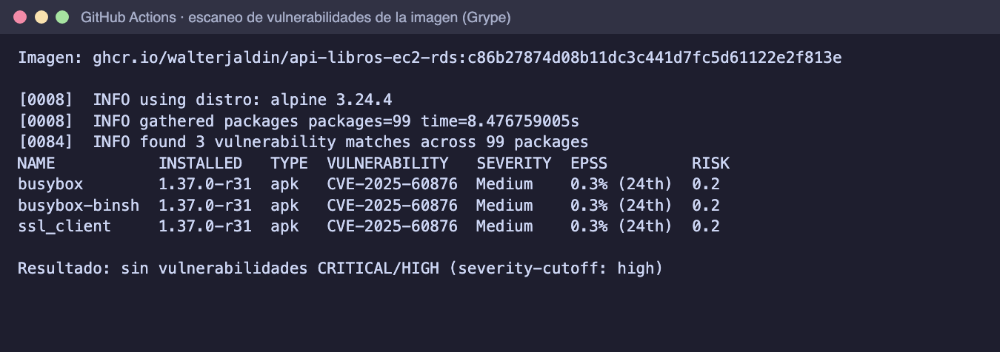

**Log del deploy:** apertura temporal del 22, verificación de `/health` y `/libros` antes de activar, y cierre del 22:

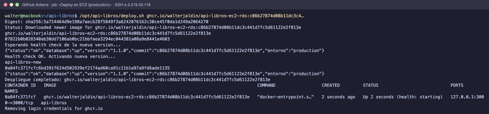

**Verificación posterior desde Internet** (`/health` con el SHA desplegado, `/libros` y CRUD):


### 4.6 Pull Request: solo CI, sin despliegue

Se abrió el [PR #3](https://github.com/walterjaldin/api-libros-ec2-rds/pull/3) con un cambio en `/health` y la versión `1.2.0`. En el PR solo se ejecutó el workflow **CI** (`on: pull_request`); `cd.yml` no se dispara en PRs:


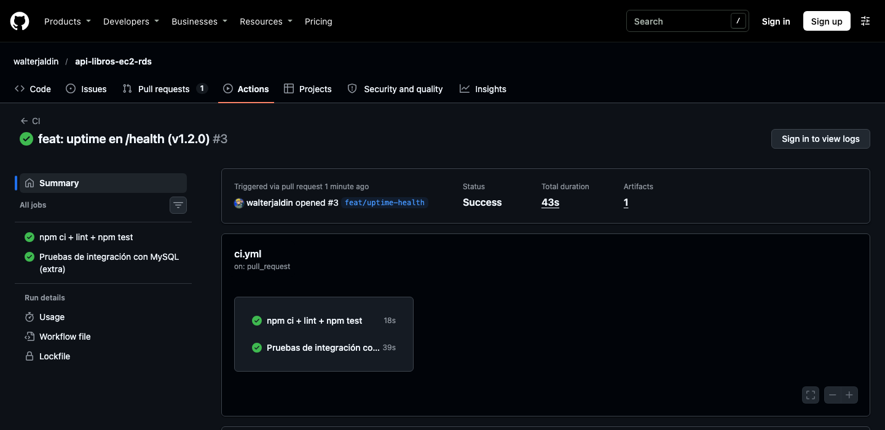

### 4.7 Despliegue exitoso con cambio visible (v1.1.0 → v1.2.0)

Al fusionar el PR #3 en `main`, `cd.yml` desplegó la nueva versión de forma automática. El cambio es visible en `/health`: el campo `version` pasa de `1.1.0` a `1.2.0` y aparece el campo nuevo `uptime_s`.

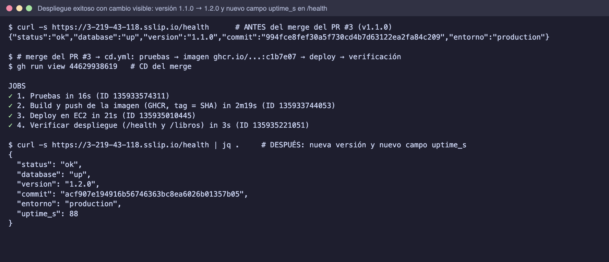

### 4.8 Fallo en el despliegue: se conserva la versión anterior

Para demostrar el comportamiento ante fallos, `cd.yml` acepta una entrada manual `simular_fallo`. Con ella, la nueva versión arranca con un `DB_HOST` inválido, así que su `/health` responde `503`. Resultado:

- La verificación previa falla y el job **3. Deploy** termina en error.
- El job **4. Verificar** no se ejecuta.
- La regla temporal del 22 se elimina igualmente.
- Producción **sigue sirviendo la v1.2.0 anterior**. Es el mismo contenedor: su `uptime_s` siguió aumentando.

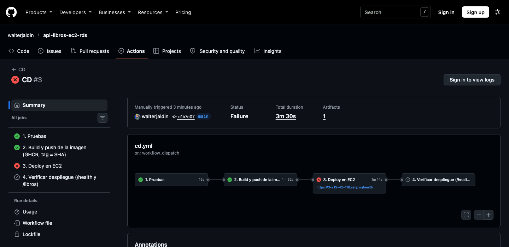

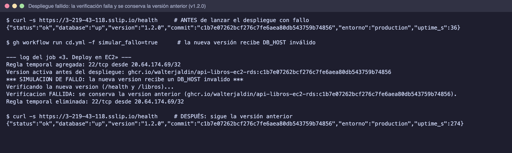

### 4.9 Rollback manual

Cada imagen queda en GHCR con el SHA de su commit. El workflow [`rollback.yml`](./.github/workflows/rollback.yml) recibe un tag y lo despliega con la **misma verificación** del CD. Se volvió a la v1.1.0, y los datos siguieron intactos porque viven en RDS. Después se regresó a la v1.2.0:

```bash
gh workflow run rollback.yml -f tag=994fce8fef30a5f730cd4b7d63122ea2fa84c209   # v1.1.0
gh workflow run rollback.yml -f tag=acf907e194916b56746363bc8ea6026b01357b05   # v1.2.0
```

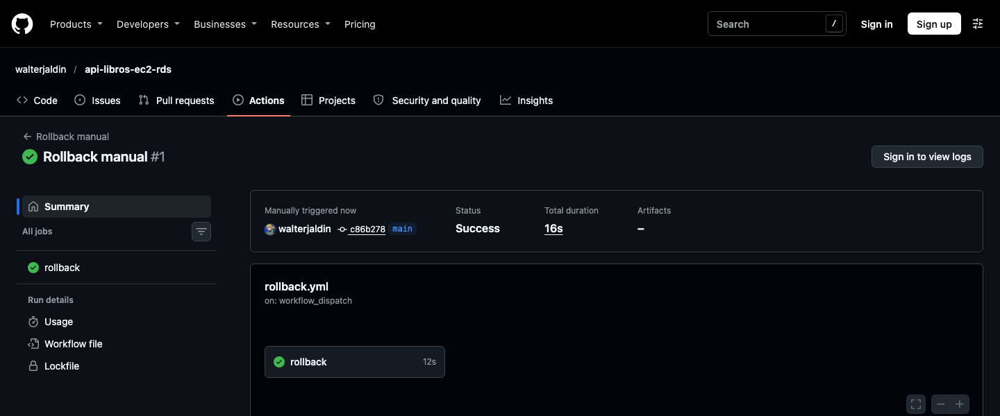

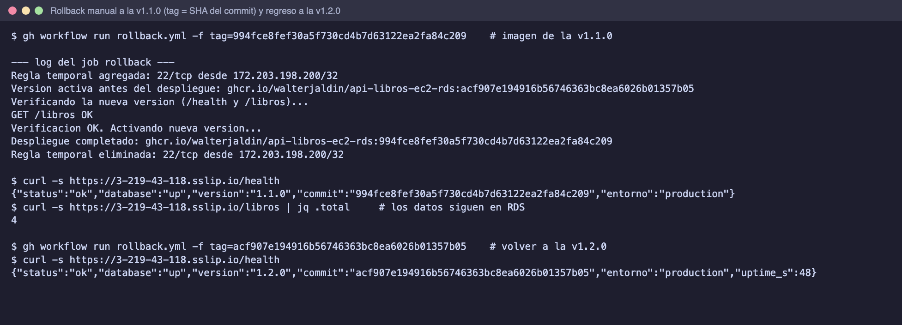


**Historial de ejecuciones:**

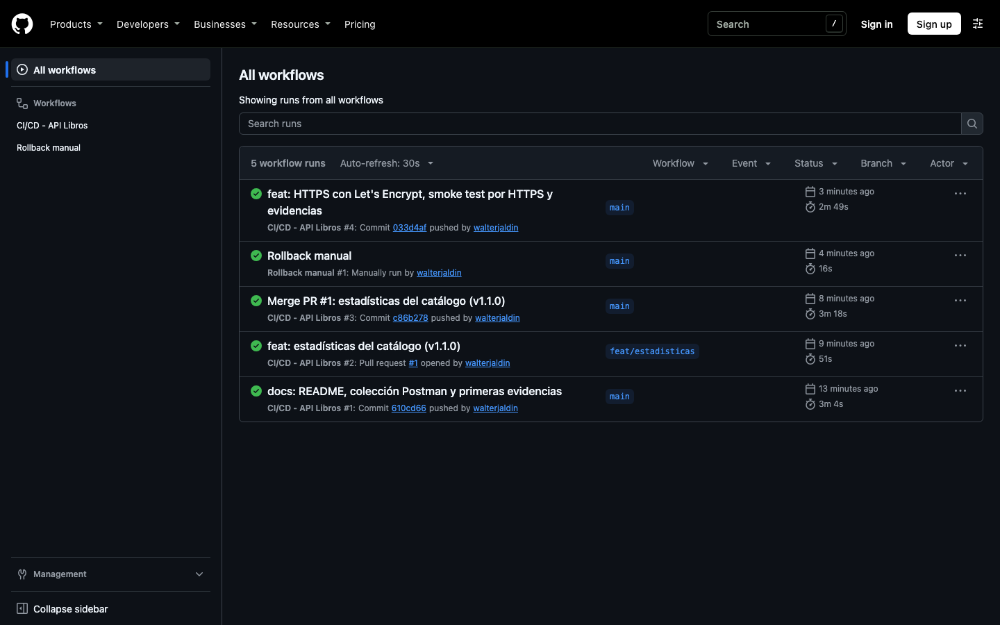

---
