# Segundo examen parcial

**Trabajando en la Nube (COM610)** 

**Docente:** Ing. Marcelo Quispe Ortega

**Estudiante:** Walter Jaldin Gonzales

**Repositorio:** [https://github.com/walterjaldin/api-libros-ec2-rds](https://github.com/walterjaldin/api-libros-ec2-rds)


| Recurso                       | URL                                                                                                                      |
| ----------------------------- | ------------------------------------------------------------------------------------------------------------------------ |
| API pública (HTTPS)           | [https://3-219-43-118.sslip.io](https://3-219-43-118.sslip.io)                                                           |
| Health check                  | [https://3-219-43-118.sslip.io/health](https://3-219-43-118.sslip.io/health)                                             |
| Swagger / OpenAPI             | [https://3-219-43-118.sslip.io/docs](https://3-219-43-118.sslip.io/docs)                                                 |
| Acceso directo por Elastic IP | [http://3.219.43.118/health](http://3.219.43.118/health)                                                                 |
| Pipeline (GitHub Actions)     | [https://github.com/walterjaldin/api-libros-ec2-rds/actions](https://github.com/walterjaldin/api-libros-ec2-rds/actions) |


---

---

## 1. Resumen de la solución


| Ejercicio  | Qué se implementó                                                                                                                                                                                                                                                                                                                                                                                                                                                                                                                                                                     |
| ---------- | ------------------------------------------------------------------------------------------------------------------------------------------------------------------------------------------------------------------------------------------------------------------------------------------------------------------------------------------------------------------------------------------------------------------------------------------------------------------------------------------------------------------------------------------------------------------------------------- |
| **Tema 4** | API REST de libros con CRUD completo, validaciones, paginación, búsqueda, estadísticas y documentación Swagger. Se despliega en una **EC2 t3.micro (Ubuntu 24.04)** con Elastic IP, detrás de **Nginx** .Persiste en **Amazon RDS for MySQL 8.4** privada; el puerto 3306 solo acepta tráfico desde el Security Group de la EC2. La contraseña maestra de RDS la gestiona **AWS Secrets Manager**.                                                                                                                                                                                    |
| **Tema 5** | 36 pruebas automatizadas (Jest + Supertest): unitarias con repositorio en memoria e **integración contra MySQL real** (service container en CI), con umbral de cobertura del 80 %. Pipeline de **GitHub Actions**: `lint` + `test` → `build` de imagen Docker multi-stage + **escaneo de vulnerabilidades (Grype)** + push a **GHCR** → `deploy` por SSH a la misma EC2 con **health check** previo al cambio de versión → **smoke test** CRUD contra la URL pública. Entorno `production` con *Environment Secrets*, flujo de **Pull Request** (solo CI) y workflow de **rollback**. |


## 2. Desarrollo de la API REST de libros

### 2.1 Estructura del código


| Archivo                                                                          | Responsabilidad                                                                                                                        |
| -------------------------------------------------------------------------------- | -------------------------------------------------------------------------------------------------------------------------------------- |
| [`src/server.js`](./src/server.js)                                               | Arranque: crea el pool de MySQL, ejecuta la migración idempotente y levanta Express.                                                   |
| [`src/app.js`](./src/app.js)                                                     | `/`, `/health`, Swagger (`/docs`, `/openapi.json`), 404 y manejador central de errores (JSON mal formado → 400, ISBN duplicado → 409). |
| [`src/routes.js`](./src/routes.js)                                               | CRUD `/libros` (GET lista y por id, POST, PUT, PATCH, DELETE) y `/libros/estadisticas`.                                                |
| [`src/validation.js`](./src/validation.js)                                       | Validación de campos: obligatorios, tipos, longitudes, rango de año, ISBN‑10/13, campos no permitidos.                                 |
| [`src/repositories/librosRepository.js`](./src/repositories/librosRepository.js) | Consultas SQL parametrizadas (sin riesgo de inyección SQL).                                                                            |
| [`sql/schema.sql`](./sql/schema.sql)                                             | Tabla `libros` (InnoDB, utf8mb4, ISBN único, índices por autor y género).                                                              |


### 2.2 Endpoints


| Método | Ruta                                     | Descripción                                            | Códigos         |
| ------ | ---------------------------------------- | ------------------------------------------------------ | --------------- |
| GET    | `/health`                                | Estado de la API y de RDS, versión y commit desplegado | 200 / 503       |
| GET    | `/libros?q=&autor=&genero=&page=&limit=` | Lista paginada con filtros                             | 200             |
| GET    | `/libros/estadisticas`                   | Total, disponibles y libros por género (v1.1.0)        | 200             |
| GET    | `/libros/:id`                            | Obtiene un libro                                       | 200 / 400 / 404 |
| POST   | `/libros`                                | Crea (`titulo` y `autor` obligatorios)                 | 201 / 400 / 409 |
| PUT    | `/libros/:id`                            | Reemplaza                                              | 200 / 400 / 404 |
| PATCH  | `/libros/:id`                            | Actualización parcial                                  | 200 / 400 / 404 |
| DELETE | `/libros/:id`                            | Elimina                                                | 204 / 400 / 404 |


---

## 3. Despliegue en Amazon EC2 con persistencia en Amazon RDS

### 3.1 Creación de la infraestructura 

La infraestructura se creó en la región **us-east-1 (Norte de Virginia)** 

#### Paso 1 — Llaves SSH

Se generaron dos pares de llaves **ed25519** en mi equipo, fuera del repositorio:

- `admin-api-libros`: para administrar la EC2.
- `github-actions-deploy`: exclusiva para el pipeline de despliegue.

Solo las llaves **públicas** se suben a AWS.

```bash
ssh-keygen -t ed25519 -C admin-api-libros -f keys/admin_ed25519
ssh-keygen -t ed25519 -C github-actions-deploy -f keys/deploy_ed25519
```


#### Paso 2 — VPC

Se usó la **VPC por defecto** (`vpc-0472baee7872fd6dc`, `172.31.0.0/16`), donde quedan la EC2 y la RDS para que se comuniquen por la red privada.

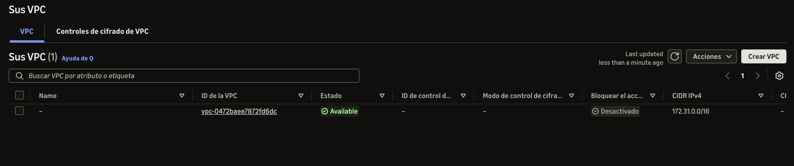

#### Paso 3 — Security Groups

Se creó `ec2-libros-sg` para la EC2, con los puertos 22, 80 y 443. También se creó `rds-libros-sg` para la base de datos, que solo permite el 3306 **desde el SG de la EC2**. El detalle de las reglas está en la sección 3.2.


#### Paso 4 — Base de datos Amazon RDS for MySQL

Se creó la instancia `rds-libros` con estas características:

- MySQL 8.4, clase `db.t4g.micro`, 20 GB gp3.
- **Sin acceso público**.
- Base inicial `db_libros`.
- Asociada a `rds-libros-sg`.

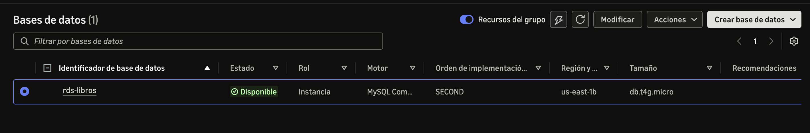

#### Paso 5 — Secreto en AWS Secrets Manager

Al crear la RDS se generó automáticamente el secreto `rds!db-89c38d6a-...` con el usuario y la contraseña maestra.

#### Paso 6 — Rol IAM para la EC2

Se creó el rol `ec2-api-libros-role` con la política `leer-secreto-rds`. Esa política solo permite `secretsmanager:GetSecretValue` sobre el secreto de la RDS. Después se creó el perfil de instancia `ec2-api-libros-profile` para asociar el rol a la EC2.

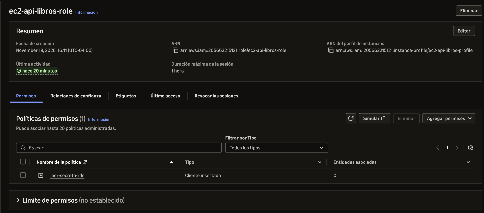

#### Paso 7 — Par de claves en EC2

Se importó la llave pública de administración como el key pair `admin-api-libros`.

#### Paso 8 — Instancia EC2

Se lanzó la instancia `ec2-api-libros` con estas características:

- Ubuntu Server 24.04, `t3.micro`, disco gp3 de 12 GB.
- Key pair `admin-api-libros`.
- SG `ec2-libros-sg`.
- Perfil IAM `ec2-api-libros-profile`.

#### Paso 9 — Elastic IP

Se reservó una Elastic IP y se asoció a la instancia, para que la dirección pública (`3.219.43.118`) no cambie si la EC2 se reinicia.


#### Paso 10 — Verificación de la EC2

Se ingresó por SSH y se comprobó que Docker, Nginx  quedaron instalados.

```bash
ssh -i keys/admin_ed25519 ubuntu@3.219.43.118
cloud-init status
docker --version && nginx -v 
```

### 3.2 Security Groups

**EC2 (`ec2-libros-sg`)**: HTTP 80 y HTTPS 443 abiertos para IPv4 e IPv6, y SSH 22. No hay reglas para 3000 ni 3306.


**RDS (`rds-libros-sg`)**: una única regla, MySQL/Aurora 3306 cuyo **origen es el Security Group de la EC2** (`sg-0b465e9ba06a34c6e`), no una IP ni `0.0.0.0/0`.

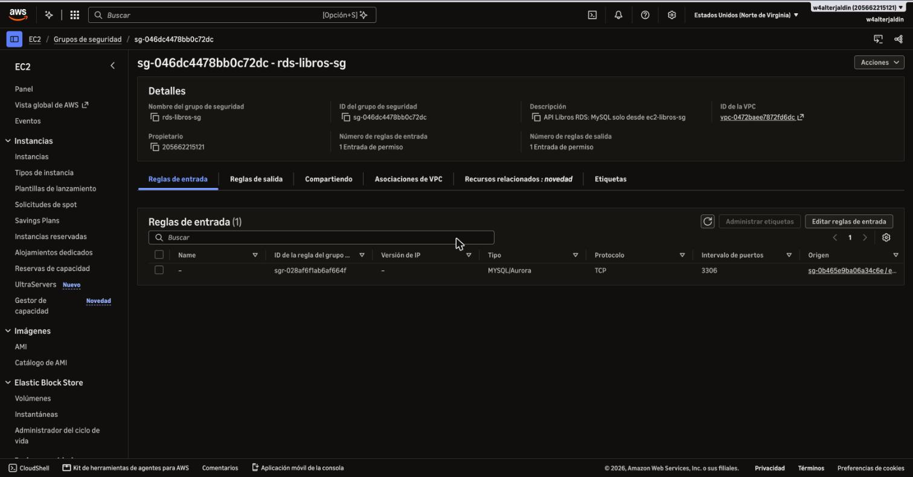

### 3.3 Instancia EC2

Instancia `ec2-api-libros` (`t3.micro`) en ejecución, con Elastic IP `3.219.43.118`, rol IAM `ec2-api-libros-role` e IMDSv2 obligatorio.

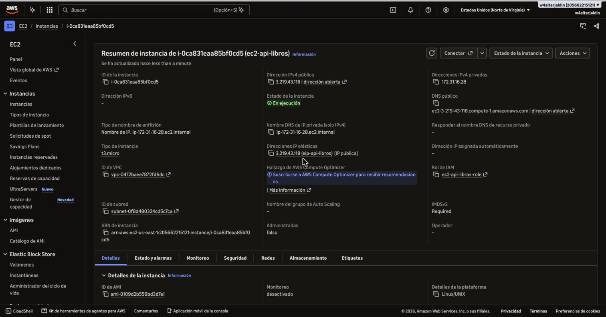

### 3.4 Amazon RDS privada

`PubliclyAccessible = False`, MySQL 8.4.11, `db.t4g.micro`, base inicial `db_libros` y la misma VPC que la EC2:

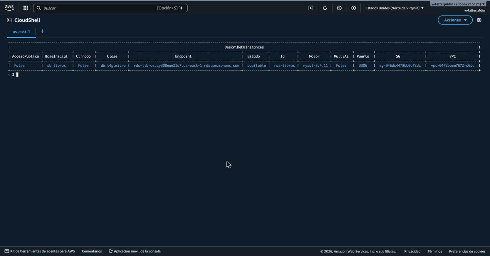

En la consola de RDS se ve que la puerta de enlace a Internet está **desactivada** y que las credenciales maestras están en **Secrets Manager**:


Reglas del grupo de seguridad asociadas a la base de datos (entrada solo desde el SG de la EC2):


### 3.5 Usuario de la aplicación y conexión EC2 → RDS

1. Crea el usuario `usr_libros` con una contraseña y solo los permisos `SELECT, INSERT, UPDATE, DELETE, CREATE, ALTER, INDEX` sobre `db_libros`.

```bash
mysql -h "$ENDPOINT" -u "$MASTER_USER" <<SQL
CREATE DATABASE IF NOT EXISTS db_libros CHARACTER SET utf8mb4 COLLATE utf8mb4_unicode_ci;
CREATE USER IF NOT EXISTS 'usr_libros'@'%' IDENTIFIED BY '${APP_PW}';
ALTER USER 'usr_libros'@'%' IDENTIFIED BY '${APP_PW}';
GRANT SELECT, INSERT, UPDATE, DELETE, CREATE, ALTER, INDEX ON db_libros.* TO 'usr_libros'@'%';
FLUSH PRIVILEGES;
SQL
unset MYSQL_PWD
```

La conexión desde la EC2 llega a RDS por su **IP privada** (`172.31.97.71`) en el puerto 3306. El usuario de la aplicación tiene los permisos mínimos:

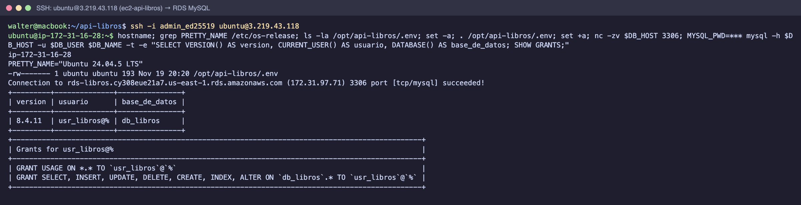

### 3.6 Despliegue de la API

El despliegue lo realiza el pipeline del Tema 5 (sección 4.5). En la EC2 queda el contenedor `api-libros` publicado solo en `127.0.0.1:3000`; Nginx escucha en 80/443; el `.env` tiene permisos `600`, y `certbot.timer` renueva el certificado:

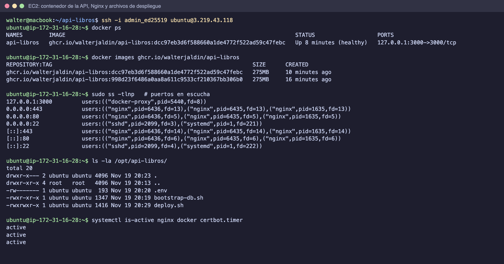

### 3.7 Verificación de puertos expuestos

Desde Internet solo responden 22, 80 y 443. Los puertos 3000 (Node.js) y 3306 (MySQL) no son accesibles, y el endpoint de RDS solo resuelve a una IP privada de la VPC:


### 3.8 HTTPS con certificado válido

Como no contamos con un subdominio propio, se usó **sslip.io**, un DNS público que resuelve `3-219-43-118.sslip.io` → `3.219.43.118`, y se obtuvo un certificado gratuito de **Let's Encrypt** con certbot. 

```bash
certbot certonly --webroot -w /var/www/html -d "$DOMAIN" --agree-tos --register-unsafely-without-email --non-interactive
cat > /etc/letsencrypt/options-ssl-nginx.conf <<CONF
ssl_session_cache shared:le_nginx_SSL:10m;
ssl_session_timeout 1440m;
ssl_session_tickets off;
ssl_protocols TLSv1.2 TLSv1.3;
ssl_prefer_server_ciphers off;
ssl_ciphers "ECDHE-ECDSA-AES128-GCM-SHA256:ECDHE-RSA-AES128-GCM-SHA256:ECDHE-ECDSA-AES256-GCM-SHA384:ECDHE-RSA-AES256-GCM-SHA384:ECDHE-ECDSA-CHACHA20-POLY1305:ECDHE-RSA-CHACHA20-POLY1305";
CONF
```

El HTTP del dominio redirige con `301` a HTTPS. El acceso directo por la Elastic IP se mantiene por HTTP.

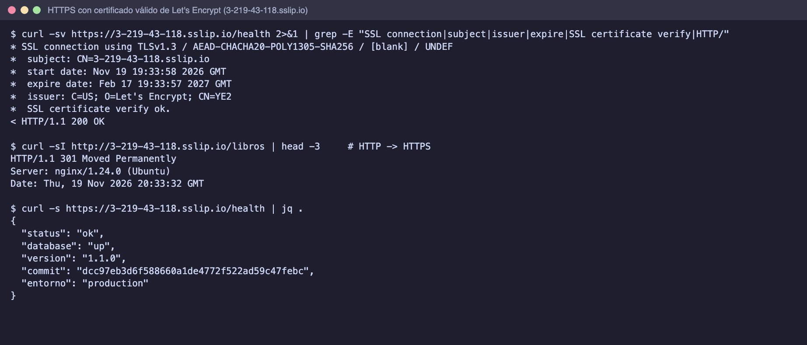

### 3.9 Operaciones CRUD y persistencia en RDS

Se ejecutaron todas las operaciones desde mi equipo contra la URL pública:

- **POST** → `201` con cabecera `Location`.
- Listado con filtro por género.
- **PATCH** y **PUT**.
- Validaciones: `400` con detalle de los errores, `409` por ISBN duplicado y `404` por id inexistente.
- Estadísticas del catálogo.

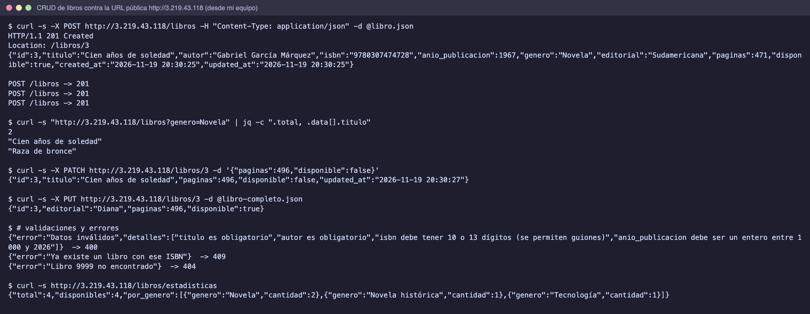

**DELETE y persistencia:** el libro creado aparece al consultar **directamente la tabla en RDS** desde la EC2. Tras el `DELETE` (`204`), la API responde `404` y en RDS ya no existe. El resto de los registros permanece en la base de datos, independiente del ciclo de vida del contenedor:


Vista en el navegador de la documentación Swagger, del listado y del health check:


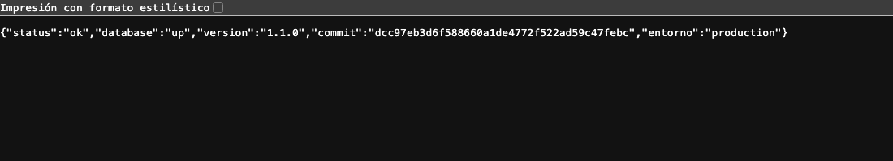

---

## 4. Pruebas automatizadas y CI/CD con GitHub Actions

### 4.1 Pruebas automatizadas


| Tipo             | Archivo                                                                              | Qué cubre                                                                                                                                             |
| ---------------- | ------------------------------------------------------------------------------------ | ----------------------------------------------------------------------------------------------------------------------------------------------------- |
| Unitarias        | [`tests/unit/validation.test.js`](./tests/unit/validation.test.js)                   | Reglas de validación, normalización de ISBN, modo parcial, `parseId`.                                                                                 |
| Unitarias (HTTP) | [`tests/unit/app.test.js`](./tests/unit/app.test.js)                                 | Todos los endpoints con un repositorio en memoria: CRUD, filtros, paginación, 400/404/409/500, JSON mal formado, `/health` 200/503, Swagger.          |
| Integración      | [`tests/integration/libros.mysql.test.js`](./tests/integration/libros.mysql.test.js) | La API contra **MySQL 8.4 real**: migración idempotente, inserción y lectura directa en la tabla, ISBN único, PATCH, búsqueda, estadísticas y DELETE. |


**Lint local** (ESLint, 0 errores, 0 advertencias):

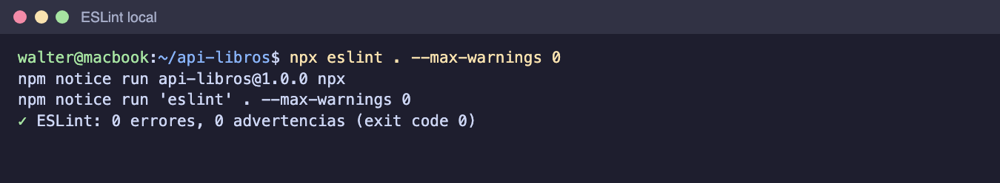

**Pruebas locales** con MySQL en Docker: 36 pruebas en verde y cobertura de 97–99 % en líneas y sentencias, por encima del umbral configurado del 80 %:

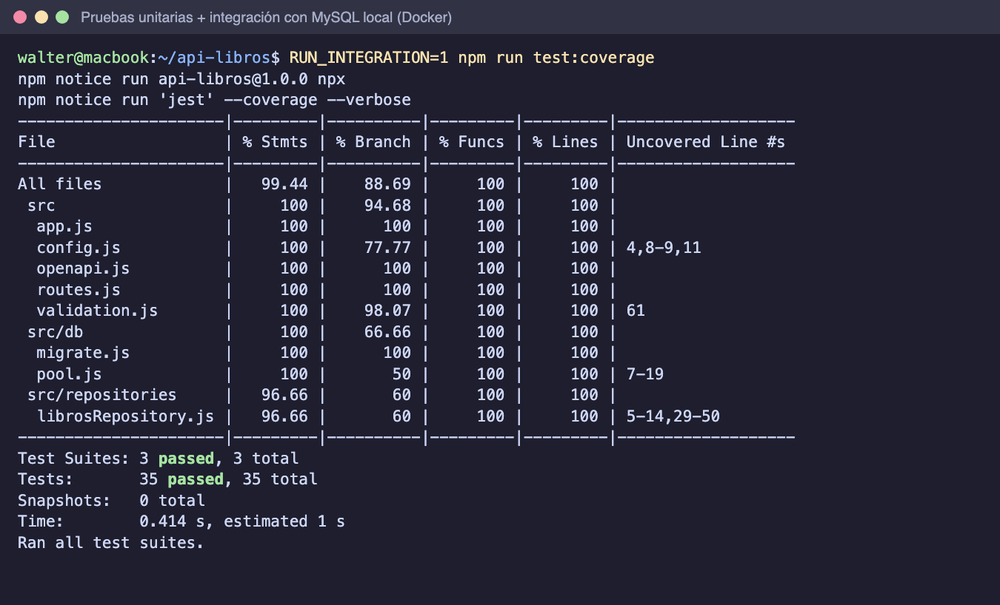

### 4.2 Imagen Docker multi-stage

El [`Dockerfile`](./Dockerfile) tiene tres etapas:

1. **builder**: ejecuta `lint` y `test` dentro del build; si fallan, la imagen no se genera.
2. **prod-deps**: instala solo las dependencias de producción.
3. **runtime**: `node:22-alpine` con parches del sistema, sin npm, ejecutándose como usuario `node` (no root), con `HEALTHCHECK` y etiquetas OCI de versión y commit.

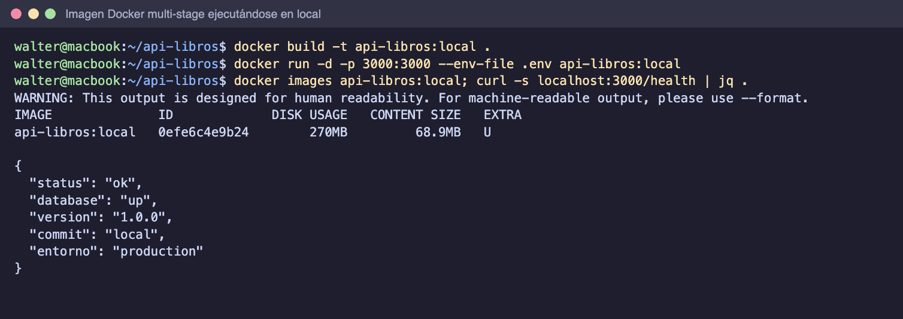

### 4.3 Secretos y entorno `production`

Las credenciales de despliegue son **Environment Secrets** del entorno `production`. La URL pública (`API_URL`) y el interruptor `DEPLOY_ENABLED` son variables del repositorio (no secretas).


| Nombre            | Tipo                              | Uso                                            |
| ----------------- | --------------------------------- | ---------------------------------------------- |
| `SSH_HOST`        | Environment secret (`production`) | Elastic IP de la EC2                           |
| `SSH_USER`        | Environment secret (`production`) | `ubuntu`                                       |
| `SSH_PRIVATE_KEY` | Environment secret (`production`) | Llave privada **exclusiva** del pipeline       |
| `API_URL`         | Variable                          | URL usada por el smoke test                    |
| `DEPLOY_ENABLED`  | Variable                          | Activa el CD una vez creada la infraestructura |
| `GITHUB_TOKEN`    | Automático                        | Push/pull de la imagen en GHCR                 |


### 4.4 Workflow de CI/CD

Archivo: [`.github/workflows/ci-cd.yml`](https://github.com/walterjaldin/api-libros-ec2-rds/blob/main/.github/workflows/ci-cd.yml).


| Job                                             | Cuándo             | Qué hace                                                                                                                                                 |
| ----------------------------------------------- | ------------------ | -------------------------------------------------------------------------------------------------------------------------------------------------------- |
| **Lint (ESLint)**                               | push, PR           | `npm ci` + `npm run lint`                                                                                                                                |
| **Pruebas unitarias + integración (MySQL)**     | push, PR           | Levanta `mysql:8.4` como *service container*, ejecuta `npm run test:coverage` (umbral 80 %), publica la cobertura en el resumen y como artefacto         |
| **Build imagen Docker + escaneo + push (GHCR)** | solo push a `main` | Build multi-stage con caché de GitHub Actions, push con tags `SHA`, `v<versión>` y `latest`, escaneo con **Grype**                                       |
| **Deploy en EC2 (production)**                  | tras el build      | SSH a la EC2: `docker login ghcr.io` con el token temporal del job, descarga [`deploy/deploy.sh`](./deploy/deploy.sh) del mismo commit y lo ejecuta      |
| **Smoke test contra la URL pública**            | tras el deploy     | Verifica que `/health` reporte `status=ok`, `database=up` y **el mismo SHA del commit**; luego crea, consulta, modifica y elimina un libro en producción |


**Estrategia de despliegue con health check** ([`deploy/deploy.sh`](./deploy/deploy.sh)):

1. Arranca la nueva versión como `api-libros-new` en `127.0.0.1:3001`.
2. Espera hasta 60 s a que `/health` responda `200`. Eso implica que la nueva imagen se conecta a RDS.
3. Si responde bien, reemplaza al contenedor activo en `127.0.0.1:3000` (al que apunta Nginx). Si falla, elimina el contenedor nuevo, **mantiene la versión anterior** y el job termina con error.

### 4.5 Primera ejecución completa (v1.0.0)

El primer push con el despliegue habilitado ejecutó todos los jobs con éxito y dejó en producción la versión `1.0.0` (commit `610cd66`).

### 4.6 Flujo con Pull Request: solo CI

Se creó la rama `feat/estadisticas` con el nuevo endpoint `GET /libros/estadisticas`, sus pruebas y la versión `1.1.0`, y se abrió el [PR #1](https://github.com/walterjaldin/api-libros-ec2-rds/pull/1). En el PR solo se ejecutan **lint y pruebas**; build, deploy y smoke test se **omiten**, de modo que nada llega a producción sin pasar por `main`:

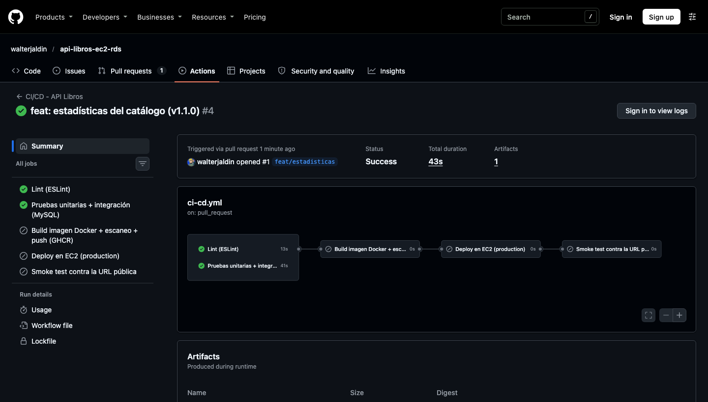

### 4.7 Merge a `main`: despliegue continuo de la v1.1.0

Al hacer merge del PR, el pipeline completo se ejecutó automáticamente y desplegó la v1.1.0:


**Log del job de pruebas en CI** (MySQL como *service container*):

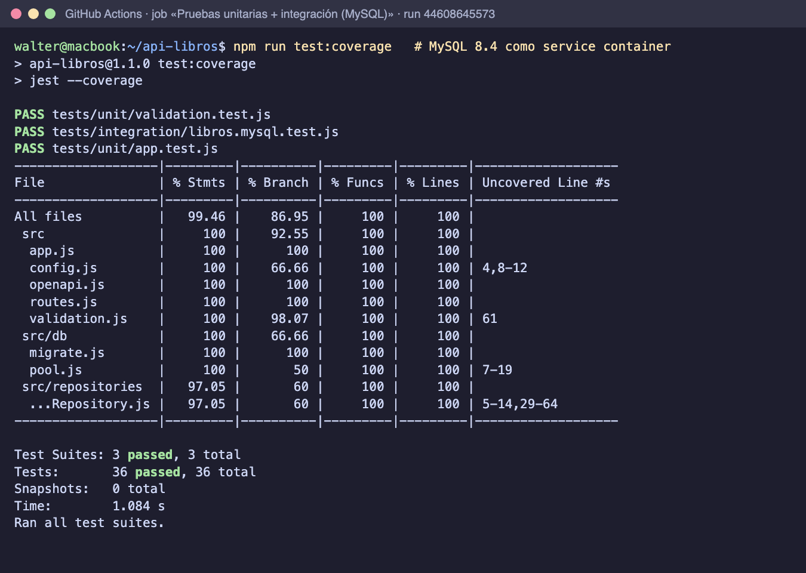

**Escaneo de vulnerabilidades (Grype):** la imagen no tiene vulnerabilidades **CRITICAL ni HIGH**. Hay 3 de severidad **MEDIUM** en `busybox`, que proviene de la imagen base Alpine y no tiene parche disponible. El job está configurado con `severity-cutoff: high` y publica la tabla en el resumen del workflow.


**Log del despliegue con health check:** se ve cómo la nueva versión se valida antes de activarse:


**Smoke test contra producción:** `/health` reporta el SHA del commit desplegado y el CRUD funciona sobre RDS:


**Historial de ejecuciones:**


### 4.8 Rollback

Cada imagen queda en GHCR con el SHA de su commit. El workflow [`rollback.yml`](./.github/workflows/rollback.yml) (`workflow_dispatch`) recibe un tag y lo despliega con el **mismo script y el mismo health check**. Para probarlo se volvió a la v1.0.0:

```bash
gh workflow run rollback.yml -f tag=610cd66248b7128e1bebd141b0d1a9edf06575da
```


Resultado: producción responde con `version: 1.0.0`, el endpoint `/libros/estadisticas` (que no existía en esa versión) deja de estar disponible, y **los datos siguen intactos** porque viven en RDS y no en el contenedor:


Luego se volvió a la última versión (*roll-forward*) con un nuevo push a `main`:


---